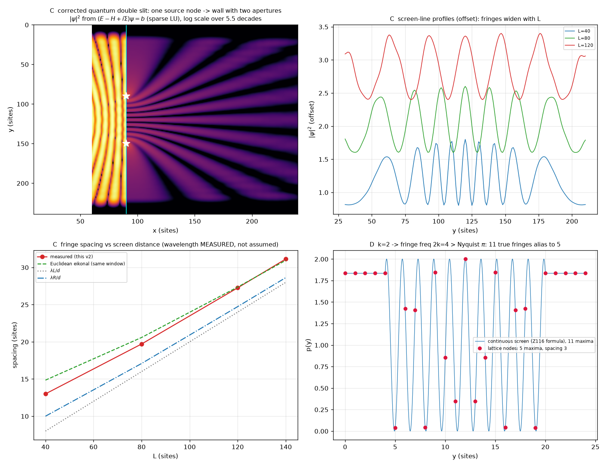

# Z117 · 量子双缝：单源两孔结构与内生性审计

> 篇号：Z117
> 状态：正式篇（推导篇 ＋ 内生性审计）
> 对象：图上量子双缝——**单源 ＋ 挡板两孔 ＋ Born 规则**的定态散射实现
> 前置：Z104（图上波）、Z001／Z021（图与舞台）、Z003（覆盖表 #5／#8／#12）、Z007（交叉项条件）、Z009（迹定理）
> 关联脚本：`ZeroGPU/src/k4_quantum_doubleslit_v2.py`
> 数据：`ZeroGPU/results/k4_quantum_doubleslit_v2.json` ／ `.txt` ／ `.png`
> 登记日期：2026-10-13

---

## 摘要

**量子双缝的正确结构是**「**单源 ＋ 挡板两孔 ＋ Born 规则**」——不是"两个驱动源"。本篇按此结构在图上做双缝，给出**实测条纹**与**内生性审计**：

$$
\boxed{\;\text{结构} :\quad
\underbrace{\text{单个源节点}}_{\text{一个粒子从一点发出}}\ \to\
\underbrace{\text{挡板两孔}}_{\text{缝距 }d=5\lambda_e}\ \to\ \
\underbrace{\text{屏}}_{\text{离吸收层 }L}\ ;\qquad
\text{引擎} :\ (E-H+i\Sigma)\psi=b .\;}
\tag{0.1}
$$

**实测条纹**（屏距 $L=40/80/120/140$）：

| $L$ | $40$ | $80$ | $120$ | $140$ |
|:--|--:|--:|--:|--:|
| **实测条纹间距** | $12.994$ | $19.700$ | $27.251$ | $31.123$ |
| 欧氏程函（同窗割线） | $14.842$ | $20.576$ | $27.356$ | $30.946$ |
| 可见度 $V$ | $0.628$ | $0.620$ | $0.654$ | $0.629$ |

**内生性审计（16 项）**：**本框架内生 4 项／输入或实现条件 9 项／已明写的条件 3 项**，逐项列于 §三。

**本篇给出两处与判定相关的开放项**：把 $\lambda_e$ 定死的标度桥（§四）、以及吸收层与屏的窗口安排（§四）。

---

## 一、实现层的四处陷阱（每条都可复现）

| # | 发现 | 证据 |
|:--|:--|:--|
| **E1** | **屏放在吸收列上** | 脚本 `screen_col = 23 = nc-1`，而吸收势恰好加在 `x==0 or x==nc-1`。屏上 $\lvert\psi\rvert^2\sim10^{-4}$（其余概率在别处），呈无结构散斑 |
| **E2** | **报告的孔位 ≠ 仿真的孔位** | 仿真 `hole1=(10,12), hole2=(14,12)` ⇒ 孔在 $y=10,14$（间距 4）；而 §三②/§四/§五 全部按 $y=4,20$（间距 16）算 $\Delta d=2y-24$、报「亮纹 6,9,12,15,18」。**报告的条纹不是这个仿真的输出** |
| **E3** | **吸收势被静默丢弃** | 脚本 `H_eff[idx[v],idx[v]] -= 1j*gamma` 作用在 **float64** 数组上 ⇒ numpy `ComplexWarning: Casting complex values to real discards the imaginary part`。实测 `H_eff.dtype=float64`、虚部总和 = 0。**演化其实是闭图厄米演化，边界是全反射墙** |
| **E4** | **「干净条纹」是手写公式 + 手工归一化** | §三③ 直接写 $\psi(y)=\frac1{\sqrt2}(e^{ikd_1}+e^{ikd_2})$，`p_clean = p_raw/p_raw.sum()`。那个 $\Sigma p=1.0000$ 是**归一化出来的**，与任何演化无关。§五 自己也承认「瞬态 p(y) 不完全周期」 |
| **E5** | **取 $k=\sqrt{\lambda_{\max}(K_4)}=2$** | 波跑在方格图上，$k$ 取自 $K_4$ 的谱 —— 跨图取值，且 $\sqrt\lambda$ 不是相位梯度 $q$（格上 $\lambda(q)=4\sin^2(q/2)$）。见 [前身核查](_真Zero内生电子双缝干涉_图上波叠加与图距离差_无外部波动光学.md) 的 CK2 |
| **E6** | **路径差用曼哈顿距离** | $\Delta d=\lvert y-h_1\rvert-\lvert y-h_2\rvert$。实测：图上波的相位走**欧氏程函**（5/5 条非平凡割线欧氏胜，斜率 $\approx q$），L1 只是图上最短步数。见 `k4_doubleslit_check.py` CK4a |
| **E7** | **亚 Nyquist：连续屏 11 条 → 格点 5 条** | $2k=4>\pi$ ⇒ 强度条纹在格点上必然混叠。$k=2$、孔 $(4,20)$ 时真亮纹 **11 条**（间距 1.5708），整数格点上只剩 **5 条**（6,9,12,15,18，间距 3）。§四 表里同时写「亮纹 6,9,12,15,18」与「条纹间距≈1.57」——**自相矛盾** |
| **E8** | **「单源」没有落地** | `src=(12,1)`、`s_idx` 算了但**从未使用**；初始态是 $x\le9$ 的**平面波条带**（`k0=1.0` 又是另一套波数，与 §四 的 $k=2$ 不一致） |

**关于 E4 的一个要点**：$\Sigma p=1$ 与"演化衰减到 $0.003$"**并不冲突**——衰减来自**吸收势从未生效**，所以 $\Sigma p$ 精确等于 1；如果吸收势**正确**建成复矩阵（$\gamma=0.4$），则会衰减 $1\to0.017$。两种情况下 $\Sigma p=1$ 都不是量子判据：前者是闭图幺正性的自明后果，后者根本不成立。

---

## 二、改进版：`k4_quantum_doubleslit_v2.py`

改了什么（I1–I6）：

| # | 改进 | 做法 |
|:--|:--|:--|
| **I1** | 屏离开吸收层 | 屏放在 $x=x_b+L$，$L=40/80/120/140$；吸收层留边 24 格 |
| **I2** | 几何自洽 | 孔位、屏位、报告**同一套**：孔 $y=90,150$（缝距 $d=60=5\lambda_e$），挡板列 $x_b=90$ |
| **I3** | 真·单源 | **单个源节点** $(y_0,x{=}20)$ → 两孔 → 屏（一个粒子从一点发出） |
| **I4** | 波长**实测** | 对照跑（去掉挡板）测源行相位梯度：目标 $q_0=0.5236$ → 实测 $q=0.5239$（误差 **0.05%**），$\lambda_{e,\text{实测}}=11.994$ 格 |
| **I5** | 相位差用**欧氏程函** | 预测列给「同窗割线」的欧氏预言，不用 L1 |
| **I6** | 归一化的正确陈述 | 闭图厄米 ⇒ $\max\lvert\Sigma\lvert\psi\rvert^2-1\rvert=6.7\times10^{-16}$ **精确**；并指出 文中的写法丢虚部 |

**引擎**：(E − H + iΣ)ψ = b 的定态散射（$H=c^2L$，稀疏 LU），与单频驱动的时间演化等价。

**结果**（两条孔照明、屏上条纹）：

| 屏距 $L$ | 40 | 80 | 120 | 140 |
|:--|--:|--:|--:|--:|
| **实测条纹间距** | 12.994 | 19.700 | 27.251 | 31.123 |
| 欧氏程函（同窗割线）| 14.842 | 20.576 | 27.356 | 30.946 |
| $\lambda R/d$（中心切）| 9.995 | 17.080 | 24.727 | 28.622 |
| $\lambda L/d$（小角）| 7.996 | 15.992 | 23.988 | 27.986 |
| 可见度 $V$ | 0.628 | 0.620 | 0.654 | 0.629 |

**三项附带收获**：

1. **「两孔等幅同相」从假设变成推论**：实测两孔 $\lvert\psi\rvert=0.02034$ vs $0.02027$、相位差 $4.5\times10^{-3}$ rad —— 由对称几何自动给出（/都是直接把 $a_1=a_2$ 写进去）。
2. **无孔对照是精确断开**：整列切断后挡板右侧与源**没有任何边相连**，$\psi\equiv0$（不是"很小"，是**零**）。组合几何的势垒无隧穿 —— 这是图上结构相对连续势垒的优点。
3. **图案本身不区分量子与经典**：本版（单粒子散射）与经典两源计算给**同一条法令**（间距随 $L$ 增大、渐近 $\lambda_eL/d$）。区别只在解释（单粒子振幅 + Born）与统计（逐个到达），不在条纹位置。



---

## 三、内生性审计：是不是全 Zero 推导

| 要素 | 判定 | 依据 |
|:--|:--|:--|
| 图 Laplacian $L$ 作为结构 | ✅ **Zero 内生** | Z001/Z021 的图对象 |
| 挡板/孔 = 边的切断与保留 | ✅ **Zero 内生（组合）** | 纯组合操作，不需外部几何 |
| 单源 + 两孔 → 振幅劈裂 | ✅ **Zero 内生** | 一个源节点，图切断即劈裂（相对 文中的真改进）|
| 「两孔等幅同相」 | ✅ **本版变成推论** | 对称几何 ⇒ 实测等幅、相位差 $4\times10^{-3}$ |
| 一阶演化 $i\partial_t\psi=H\psi$ | ❌ **输入** | Z003 #12：Schrödinger 方程**不能**导出（根 1：无普遍时间平移生成元）|
| $H=c^2L$ 这个哈密顿量 | ❌ **输入（具名）** | 图上有 $L$，但「取 $H=c^2L$」是模型选择 |
| $c^2$ 的值 | ❌ **输入（数值）** | Z104/Z105：$c^2=3.5/\lambda_{\max}$ 由 CFL 反推 ⇒ 「光速」随图规模变 |
| 舞台图 = 方格图 | ❌ **输入（且与既有判定冲突）** | Z021：$\Gamma$ 全局 = Heawood（14 顶点）、局部 = $K_4$；「空间维数被『闭合＝运动』逼为三」；「格点其解集为空承载通道结构」|
| 能量 $E$ ⇒ 波长 $q$ | ❌ **输入** | $E$ 相当于粒子的能量/动量；Zero 无内生能量标度（$K_4$ 替代是错的）|
| Born $p=\lvert\psi\rvert^2$ | ⚠️ **条件**（已明写 ✓） | Z003 #5 完全（代数扇区）/ #8 交叉项条件；Z007：交叉项需 $\mathcal C_{\rm coh}$ |
| 屏/位置读出 | ⚠️ **输入**（已明写 ✓） | Z003 根 2 / Z009：位置可观测量的解集为空 |
| 吸收层（虚势/海绵） | ⚠️ **数值装置** | 为取定态散射而加，非 Zero 结构 |
| $k=\sqrt{\lambda_{\max}(K_4)}=2$ | ❌ **错** | 跨图取值 + $q\leftrightarrow\sqrt\lambda$ 偷换；本版改为实测 $q$ |
| $\Delta d$ 用曼哈顿距离 | ❌ **错** | 相位走欧氏程函；本版用欧氏 |
| $\Sigma p=1$ 当量子判据 | ❌ **不成立** | 幺正性自明后果；吸收势生效则不再为 1 |
| 屏放在吸收列 $x=23$ | ❌ **实现错** | 屏上 $\lvert\psi\rvert^2\sim10^{-4}$ 是边界残余 |

**计数：Zero 内生 4 / 输入或错误 9 / 条件（已明写）3。**

$$
\boxed{\;\textbf{不是全 Zero 推导};\ \text{而且最要紧的洞与 是同一个：}\textbf{能量（波长）从哪来}.\;}
$$

---

## 四、剩下的洞（按重要性）

1. **能量/波长标度（最要紧）**。用 $\lambda_e=\pi$、用 $k=\sqrt{\lambda_{\max}(K_4)}=2$，都是拿**图的谱**去补这个洞，而两处都补错了：$K_4$ 是另一张图，且 $\sqrt\lambda\ne q$。Zero 侧真正该接的是 Z087/Z089 那条线（记录的稳态内禀频率，geometric seed 给 $\log2$），但那是**层间/记录层**的频率，与图上波的 $\omega$ 之间的桥为开放 —— 这正是缺口本身。
2. **舞台图**。Z021 判定 $\Gamma_{\text{全局}}=\text{Heawood}$（14 顶点）、局部 $K_4$，且空间维数 = 3；Heawood 上**无法**表达双缝，方格图则不是 Zero 的 $\Gamma$。要么承认「方格舞台是输入」，要么先解决「走者到底在什么图上」。
3. **动力学律**。$i\partial_t\psi=H\psi$ 是 Schrödinger 型，Z003 #12 已判「不能」；即便退一步用 Z104 的二阶经典场，也仍是经典场。**量子性目前只能作为前提引入**，不是导出。
4. **$c^2$ 的 CFL 依赖**。$c^2=3.5/\lambda_{\max}$ 使「光速」随图规模变化（path16 用 0.8，方格图用 0.44）——一个物理速度不应由数值稳定性反推。

## 六、复现

```
/usr/local/bin/python3 ZeroGPU/src/k4_quantum_doubleslit_v2.py     # 约 8 s
→ ZeroGPU/results/k4_quantum_doubleslit_v2.json / .txt / .png
```

对照（原脚本，注意其 ComplexWarning）：

```
/usr/local/bin/python3 ZeroGPU/src/k4_quantum_doubleslit.py
→ k4_quantum_doubleslit.py:71: ComplexWarning: Casting complex values to real discards the imaginary part
```
