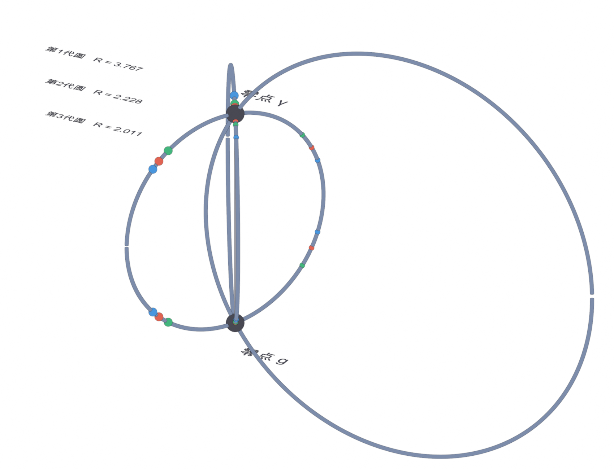
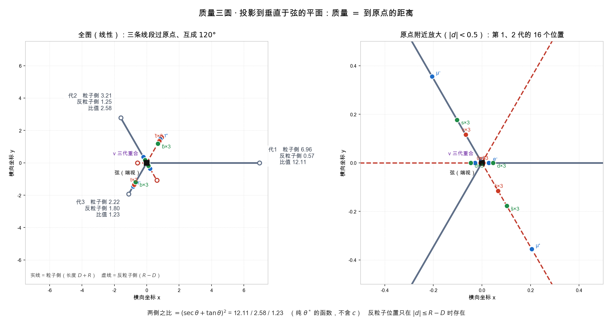
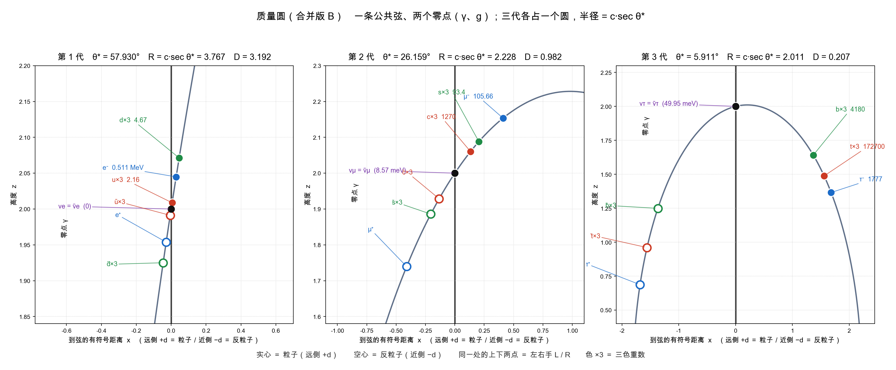

# Zb040 · 质量圆与三代：比值槽的几何、圆上的三个点、以及它们的排列

> 篇号：Zb040
> 状态：正式篇（推导篇）
> 前置：Zb003（层与词层）、Zb007（模流与内禀频率）、Zb039（振幅律与质量比）
> 登记日期：2026-10-30

## 摘要

本篇把"质量圆"写成一句可以核对的话，并算清它能约束什么：

$$
\boxed{\;\begin{aligned}
&\textbf{对数坐标}:\ \theta_{ij}:=\ln\frac{m_i}{m_j},\qquad \theta_{ji}=-\theta_{ij},\qquad \theta_{12}+\theta_{23}+\theta_{31}=0;\\
&\textbf{圆周化}:\ \text{取模}\ T\ \text{后，三点的弧和}\in T\mathbb Z\ (\text{绕数});\\
&\textbf{判别}:\ \text{等比}\iff\text{存在}\ T\ \text{使圆上等间距};\qquad \text{平方律（}1:4:9\text{）}\iff\text{任何}\ T\ \text{都不等间距}.
\end{aligned}\;}
\tag{0.1}
$$

**四条正面结果**：

1. **闭合恒等式（定理 1.2）**：任意三个质量的对数差按循环顺序求和恰为零。
2. **圆上表示（定理 2.1）**：取模 $T$ 后三点落在圆周上，弧和为 $T$ 的整数倍，且绕数可算。
3. **几何载体（命题 4.1、4.2、4.4）**：弦与圆的交点恰是两极（零点唯一）；一个质量值对应四个位置，存在的充要条件是 $d\le c\tan(\alpha/2)$；$c,R,D,\alpha$ 不进入质量；三代半径由 Zb036 §5 的三个角给出，$R_k/c=\sec\theta_k^*=(1.883,\ 1.114,\ 1.005)$。
4. **判据（命题 3.2、3.3）**：等比 ⟺ **存在某个周期** $T=3|\ln r|$ 使三点等间距；平方律则**对任何** $T$ 都不等间距——两者可区分。

**两处记账**：把"质量的对数"放到圆周上（选周期 $T$）是**结构选择（I）**；给定 $T$，三条结论是定理。§3.5 给出几何载体（弦 + 圆），其中 $c,R,D,\alpha$ 是**呈现参数**，不进入质量值。

---

## §1 对数坐标下的比值

> **定义 1.1（比值槽）.** 对三个正质量 $m_1,m_2,m_3$，定义

$$
\theta_{ij}:=\ln\frac{m_i}{m_j}\qquad(i,j\in\{1,2,3\}).
\tag{1.1}
$$

> **定理 1.2（闭合恒等式）.** 任意三个正数满足

$$
\theta_{12}+\theta_{23}+\theta_{31}=0,\qquad \theta_{ji}=-\theta_{ij}.
\tag{1.2}
$$

*证明.* 第一式：$\ln\frac{m_1}{m_2}+\ln\frac{m_2}{m_3}+\ln\frac{m_3}{m_1}=\ln\bigl(\frac{m_1m_2m_3}{m_2m_3m_1}\bigr)=\ln1=0$。第二式：$\ln\frac{m_j}{m_i}=-\ln\frac{m_i}{m_j}$。$\blacksquare$

**读法.** (1.2) 说明：三个比值里只有**两个是独立的**（第三个由闭合条件定）。这与 Zb007 命题 2.3（频率槽 = 比值槽）一致：三个正数给两个自由度。

---

## §2 圆周化

> **结构选择（I）（周期）.** 取一个周期 $T>0$，把 $\theta$ 看作圆周 $\mathbb S^1_T:=\mathbb R/T\mathbb Z$ 上的坐标。

> **定理 2.1（三点与绕数）.** 在 $\mathbb S^1_T$ 上，三个点之间的三个有序弧长满足

$$
\theta_{12}+\theta_{23}+\theta_{31}=nT,\qquad n\in\mathbb Z,
\tag{2.1}
$$

其中 $n$ 称为**绕数**。

*证明.* 由定理 1.2，左边的实数和为 $0$；在商空间 $\mathbb R/T\mathbb Z$ 中 $0$ 与 $nT$ 代表同一个点，故和 $\in T\mathbb Z$。$\blacksquare$

> **命题 2.2（绕数与排列）.** $n=0$ 当且仅当可以选一组代表元使三点在直线上按 $1,2,3$ 的顺序排列且不绕圈。

*证明.* 取定 $m_1<m_2<m_3$，则 $\theta_{12}<0<\theta_{23}$、$\theta_{31}>0$；三个实数按顺序相加为 $0$，不产生整圈。若 $n\ne0$，则把代表元搬动一周后顺序改变。$\blacksquare$

**读法.** 圆周上"质量圆"的几何内容是**三个弧长**，而闭合条件把它们压成一个二维对象（$T$ 与两个弧长，第三个由 $n$ 定）。所以"三点在圆上"本身**不含**质量比的预言——**只有额外的分布条件**（如等间距）才有内容。

---

## §3 两种分布

> **定义 3.1（等间距）.** 在圆周 $\mathbb S^1_T$ 上，称三点**等间距**，若绕一圈的三个弧长相等：

$$
\text{arc}(1\to2)=\text{arc}(2\to3)=\text{arc}(3\to1)=\frac T3 .
\tag{3.1}
$$

> **命题 3.2（等比 ⟺ 某个周期下等间距）.** 三个质量成等比（$m_i=m_0r^{\,i-1}$）当且仅当存在周期 $T$ 使三点等间距；此时 $T=3\left|\ln r\right|$。

*证明.* **（⟹）** 取 $r>1$、$T=3\ln r$。则

$$
\theta_{12}=\ln\frac1r=-\ln r,\qquad
\theta_{23}=\ln\frac1r=-\ln r,\qquad
\theta_{31}=\ln r^2=2\ln r .
$$

第三个在圆上绕过了 $T$：$2\ln r\equiv 2\ln r-3\ln r=-\ln r\ (\mathrm{mod}\ T)$。故三个弧长都是 $|\ln r|=T/3$，等间距。
**（⟸）** 若三个弧长均为 $T/3$，则相邻的质量对数差为 $\pm T/3$（同号），故 $m_{i+1}/m_i$ 是常数，即等比，且 $|\ln r|=T/3$。$\blacksquare$

> **命题 3.3（平方律的间距不等）.** 由 Zb039 命题 4.3 的平方律 $m\propto(1,4,9)$：

$$
(\theta_{12},\theta_{23},\theta_{31})=\Bigl(-\ln4,\ -\ln\tfrac94,\ \ln9\Bigr)\approx(-1.3863,\ -0.8109,\ 2.1972).
\tag{3.2}
$$

且**不存在**周期 $T$ 使这三点等间距。

*证明.* (3.2) 由定义直接代入；和为 $-1.3863-0.8109+2.1972=0$ ✓。若某个 $T$ 使三点等间距，则由命题 3.2 的（⟸）方向，两个相邻对数差的**绝对值**必须相等：$|\theta_{12}|=|\theta_{23}|$，即 $\ln4=\ln\frac94$，即 $4=\frac94$——矛盾。$\blacksquare$

**读法.** 两张表把"圆"这个图像的实际用途说清：

| 假设 | $\theta$ 的形态 | 能否找到 $T$ 使等间距？ |
|:--|:--|:--|
| 等比 $m\propto r^{\,i-1}$ | $(-\ln r,-\ln r,2\ln r)$ | **能**（$T=3|\ln r|$） |
| 平方律 $m\propto i^2$ | $(-\ln4,-\ln\frac94,\ln9)$ | **不能**（$\ln4\ne\ln\frac94$） |

两条假设给出**不同**的圆上配置，故"质量圆"是**可判别的框架**，不是装饰。

## §4 几何载体：一条弦、两个零点、四个位置

§1–§3 把质量**比**放到圆周上。本节给出另一件事：把质量**值**放到一个具体的几何里——一条弦与一族圆。

> **定义 4.0（弦与圆）.** 取公共弦 $\ell$ 为过 $(0,0,\pm c)$ 的直线。第 $k$ 代的圆 $\mathcal C_k$ 在含 $\ell$ 的平面内，半径 $R_k$，圆心到 $\ell$ 的距离

$$
D_k=\sqrt{R_k^{\,2}-c^{2}} .
\tag{4.1}
$$

圆上点按参数 $\psi$ 写作 $P=\bigl((D_k+R_k\cos\psi)\hat u_k,\ R_k\sin\psi\bigr)$（$\hat u_k\perp\ell$），故它到弦的距离是

$$
\operatorname{dist}(P,\ell)=\bigl|D_k+R_k\cos\psi\bigr| .
\tag{4.2}
$$

*证明（(4.1) 的来源）.* 弦的两端在圆上，故圆心到端点的距离为 $R_k$；端点与圆心投影的距离分别是 $c$ 与 $D_k$，故 $D_k^2+c^2=R_k^2$。$\blacksquare$

> **命题 4.1（零点唯一）.** 对任一代，

$$
\operatorname{dist}(P,\ell)=0\iff P\in\ell\cap\mathcal C_k=\{(0,0,+c),\ (0,0,-c)\}.
\tag{4.3}
$$

*证明.* 由 (4.2) 令其为零：$\cos\psi=-D_k/R_k$，两解 $\psi=\pm\arccos(-D_k/R_k)$。代入得

$$
z^2=R_k^2\sin^2\psi=R_k^2-D_k^2=c^2,\qquad x=D_k+R_k\cos\psi=0,
$$

即两解正是 $(0,0,\pm c)$。反之弦与圆的交点只有这两个。$\blacksquare$

**核验.** 取 $c=1,R=2$：$D=\sqrt3=1.732051$，$\arccos(-D/R)=2.617994$，代入得 $z=\pm1=\pm c$ 精确。

> **命题 4.2（四点存在条件）.** 给定 $|d|$，满足 $\operatorname{dist}(P,\ell)=|d|$ 的点共**四个**，当且仅当

$$
d\ \le\ R_k-D_k=c\tan\frac{\alpha_k}{2},\qquad \sin\alpha_k=\frac{c}{R_k}.
\tag{4.4}
$$

*证明.* 令 (4.2) 等于 $d$：$\cos\psi=(d-D_k)/R_k$（远侧）与 $\cos\psi=(-d-D_k)/R_k$（近侧）。两式各给 $\pm\psi$ 两解，故共四个。存在的条件是 $|\cdot|\le R_k$：远侧在 $d\le D_k+R_k$ 时恒成立；近侧等价于 $d\le R_k-D_k$。又 $R_k-D_k=R_k(1-\cos\alpha_k)$ 与 $\sin\alpha_k=c/R_k$ 合起来给 $R_k-D_k=\dfrac{c(1-\cos\alpha_k)}{\sin\alpha_k}=c\tan\dfrac{\alpha_k}{2}$。$\blacksquare$

**核验.** $c=1,R=2$：$R-D=0.267949$，$c\tan(\alpha/2)=0.267949$（$\alpha=\arcsin\frac12$），逐位相同。$d=0.168$ 时四点齐，$d=0.368$ 时近侧两点不存在。

> **推论 4.3（位置的计数）.** 每个质量值给 $4$ 个位置（远侧 $\pm z$：粒子；近侧 $\pm z$：反粒子）。四类 $A_s$ 各一条弦时零点共 $8$ 个；**一条公共弦**时全部四类的零点只落在同一对点上，零点数 $2$。

*证明.* 由命题 4.2 的四解；零点数由命题 4.1 对任一 $k$ 只给两点。$\blacksquare$

> **命题 4.4（三代半径由三个角给出）.** 由定义式 (4.4)（即 $\sin\alpha_k=c/R_k$），

$$
R_k=\frac{c}{\sin\alpha_k}.
\tag{4.5}
$$

取 $\alpha_k=\dfrac\pi2-\theta_k^{*}$（$\theta^*$ 见 Zb036 §5 的三个角）得

$$
\frac{R_k}{c}=\sec\theta_k^{*}=(1.883424,\ 1.114112,\ 1.005345).
\tag{4.6}
$$

*证明.* 代入 $\alpha_k=\pi/2-\theta_k^*$：$\sin\alpha_k=\cos\theta_k^*$，故 $R_k/c=1/\cos\theta_k^*=\sec\theta_k^*$。数值：$\sec(57.930484^\circ)=1.883424$、$\sec(26.158813^\circ)=1.114112$、$\sec(5.910703^\circ)=1.005345$。$\blacksquare$

**另一支（对照）.** 取 $\alpha_k=\theta_k^*$ 则 $R_k/c=\csc\theta_k^*=(1.180074,\ 2.268290,\ 9.710779)$——三代半径跨近一个量级，最轻一代的圆近于直线。

> **推论 4.5（$c$ 的下界）.** 由命题 4.2 的四点存在条件与 (4.5)，

$$
c\ \ge\ \max_k\frac{d_{\max,k}}{\tan(\alpha_k/2)} .
\tag{4.7}
$$

*证明.* 命题 4.2 给 $d\le c\tan(\alpha_k/2)$，对每个 $k$ 都要成立，取最大即得。$\blacksquare$

**核验（$c=2$、$\alpha=\pi/2-\theta^*$）.**

| 代 | $\theta^*$ | $R_k$ | $D_k$ | $R_k-D_k$ | $c\tan(\alpha_k/2)$ |
|--:|--:|--:|--:|--:|--:|
| $1$ | $57.930^\circ$ | $3.7668$ | $3.1920$ | $0.5748$ | $0.5748$ |
| $2$ | $26.159^\circ$ | $2.2282$ | $0.9823$ | $1.2459$ | $1.2459$ |
| $3$ | $5.911^\circ$ | $2.0107$ | $0.2071$ | $1.8036$ | $1.8036$ |

(4.7) 的下界为 $c\ge1.8657$，故所取 $c=2$ 满足。

**读法（几何参数是否进入质量）.** 质量由

$$
m_s=\kappa_s\,d^{2}
\tag{4.8}
$$

给出（$d=\operatorname{dist}(P,\ell)$，见 Zb039 的振幅平方律）。故 $c$、$R_k$、$D_k$、$\alpha_k$ **都不进入质量值**——它们是**呈现参数**：换一组 $(c,R_k)$ 只改变画法，不改变谱。

| 量 | 进不进入 $m$ | 档位 |
|:--|:--|:--|
| $d$ | 进入（平方） | 导出（距离） |
| $\kappa_s$ | 进入（线性） | 结构选择（I） |
| $c,\ R_k,\ D_k,\ \alpha_k$ | **不进入** | 呈现参数 |

**图 1（三维视图）.** 先看三维：同一条公共弦上的三代圆；$c=2$ 的呈现，三代半径分别为 $3.767$、$2.228$、$2.011$（即 $R_k/c=\sec\theta_k^*$）。三代各占一个圆，弦的两端是两个零点。

**图 2（质量三圆投影）.** 把图 1 的三代圆投影到垂直于公共弦的平面：三条线段过原点、互成 $120^\circ$；实线为粒子侧（$D+R$），虚线为反粒子侧（$R-D$），质量等于到原点的距离。数值由 Zb036 §5 的三个角给出；$c$ 只改变整体标度。

**图 3（三代圆平铺）.** 三代各占一个圆，共享公共弦；弦的两端是两个零点（图中的 Y、g）；实心/空心与左右手、粒子/反粒子对应，$\times3$ 是色重数。半径 $R_k/c=\sec\theta_k^*=(1.883,\ 1.114,\ 1.005)$。

**读法（大圆为什么看起来是空的）.** 第 1 代的圆最大（$R_1=3.767$），但它的质量点都集中在弦/零点附近（$|d|$ 小）：三维图里大圆的远端弧上没有点，是因为那里没有对应的质量值，不是漏画。三代半径由 $R_k/c=\sec\theta_k^*$ 给出，而进入质量的是到弦的距离 $d$；半径大不等于质量点分散。图 3 的第 1 代面板把横轴放大到 $|d|\lesssim0.6$，正是为了看清这个聚集。

---

## §5 记账

| 项 | 档位 | 说明 |
|:--|:--|:--|
| 对数坐标 | 定理（定义级） | $\theta=\ln$ 比值；Zb007 已用 |
| 周期 $T$ 与圆周化 | 结构选择（I） | 取多大周期是额外选择 |
| 闭合恒等式 | 定理 | 定理 1.2 |
| 等间距 ⟺ 等比 | 定理 | 命题 3.2 |
| 三代数 = 3 | 输入 | 世代的个数（Zb031 同一输入） |

---

## §6 量纲

- $\theta_{ij}$、$T$、$n$ 皆无量纲；$m_i$：质量。
- 本篇不引入有量纲常数。

---

## 自检

| 项 | 内容 | 档位 | 依据 |
|:--|:--|:--|:--|
| 定理 1.2 | 闭合恒等式 $\theta_{12}+\theta_{23}+\theta_{31}=0$ | 导出 | §1 |
| 定理 2.1／命题 2.2 | 绕数 $n$；$n=0$ 的排列刻画 | 导出 | §2 |
| 命题 3.2 | 等比 ⟺ 存在 $T$ 使等间距 | 导出 | §3 |
| 命题 3.3 | 平方律的弧长数值；任何 $T$ 都不等间距 | 导出＋数值 | §3 |
| 命题 4.1 | 零点唯一（到反射） | 导出 | §4 |
| 命题 4.2 | 四点存在条件 $|d|\le c\tan(\alpha_k/2)$ | 导出 | §4 |
| 推论 4.3 | 每个质量给四个位置 | 导出 | §4 |
| 命题 4.4 | 割线半径 $R_k/c=\sec\theta_k^*$ | 导出 | §4 |
| 推论 4.5 | $c$ 的下界 | 导出＋数值 | §4 |
