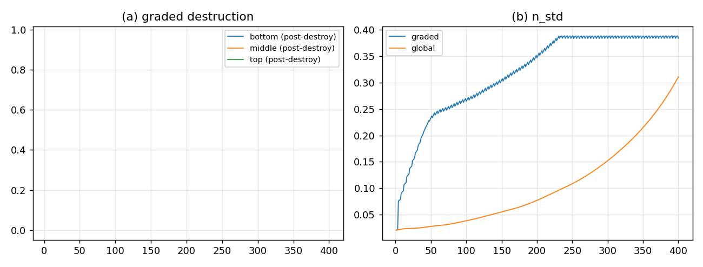

# 忠实引擎里的 16/8/4：能跑、有周期 4，但没复现观测

## 结论

把 **16/8/4 分级毁灭**接进忠实 12 通道引擎后：

- **能跑**：无 NaN、无负值，100 个毁灭周期；
- **有周期 4**：$n_{std}$ 的 FFT 在 bin 100（$400/4$）明显高于中位数；
- **但没复现观测**：分级毁灭把内容推到 $q\approx0.78$、$n_{std}\approx0.32$，而观测是 $q\approx0.068$、$n_{std}\approx0.068$；尾段仍在漂移，没有稳态。

**判定**：这条“内容 $n$ 的亚亚层簿记”实现**不采纳**；忠实引擎本身没有改动（实验在独立脚本里），所以不需要回退。失败点不在毁灭规则，而在**把 16/8/4 通道接到内容 $n$ 上**——它把内容推向了过度集中的新吸引子。

## 设置

| 项 | 值 |
|:--|:--|
| 引擎 | `zero_evo`，cycle16，12 通道全开，$c_h=1.7$ |
| 亚亚层 | 每顶点 7 通道：底 4／中 2／顶 1；4 顶点 → 16/8/4 |
| 毁灭 | 每 $T=4$：底 4 全灭；中只留最高顶点的一对；顶 1 不动 |
| 权重 | 按观测粗分组标定：底/中/顶 $=0.1724/0.2759/0.5517$ |
| 记忆 | 毁灭后保留通道记忆，L1 seed 以 $0.05$ 重填；不每步重置 |
| 步数 | 400 代（100 个毁灭周期） |

## 结果

| 量 | graded 16/8/4 | global（$T=4$ 清 $W$） | 观测 L2 |
|:--|--:|--:|--:|
| $n_{std}$ 均值 | $0.318$ | $0.104$ | $\approx0.068$ |
| $q$ 均值 | $0.777$ | $0.0628$ | $\approx0.068$ |
| 尾段底/中/顶份额 | $0.0216/0.3219/0.6565$ | — | 粗分组 $0.1724/0.2759/0.5517$ |
| 周期 4 | 有（FFT bin 100 $=0.384$） | 无 | — |

- 毁灭后底份额 $0$、中活跃 $2/8$、顶 $4/4$：**结构判据 7/7 全过**。
- 但 $n_{std}$ 从 $0.07$ 一路升到 $0.38$（图 b），$q$ 到 $0.78$；400 代仍在漂移，**不是观测的那个 L2 态**。
- 第一次尝试（每步重置通道、脉冲式毁灭）更弱：$n_{std}\sim10^{-4}$，周期 4 被洗掉；保留记忆后才出现强周期 4，但过冲。



## 读法

- **毁灭规则本身是自洽的**：底全灭、中留 2、顶不动，能在忠实引擎里产生周期 4；这支持“分级毁灭可以产生周期信号”。
- **失败在载体**：把 16/8/4 通道当成**内容 $n$ 的簿记**，重复毁灭/重填会把内容推向单点式集中（$q\approx0.78$），而不是观测的 $q\approx0.068$。
- **下一步不是调参，而是换载体**：应该把 16/8/4 作用在 **$W$ 的 16 个条目**（或 16 槽载体的纤维槽）上，而不是 $n$ 的 7 个通道；$n$ 是粗粒化读出，直接清它会把粗粒化本身推歪。
- **无新量纲锚**：16/8/4、2、$T=4$ 都是整数；profile 权重是无量纲标定，不是新锚。

## 复跑

```bash
cd ZeroGPU/src
/usr/bin/python3 zero_faithful_sublayers.py
```

| 文件 | 内容 |
|:--|:--|
| `ZeroGPU/src/zero_faithful_sublayers.py` | 12 通道引擎 + 7 通道/顶点分级毁灭 |
| `ZeroGPU/results/zero_faithful_sublayers.json` | 每代 post-destroy／post-flow、baseline、判据 |
| `ZeroGPU/results/zero_faithful_sublayers.png` | 分级毁灭份额与 $n_{std}$ 对比 |

---

*ZeroGPU · 忠实引擎 16/8/4 尝试 · 2026-10-18*
