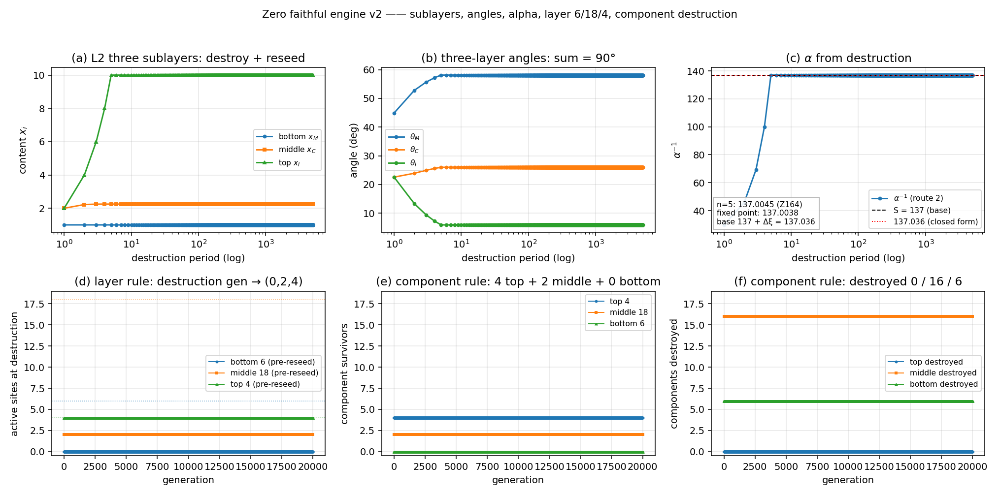

# zero_faithful_v2：把 L2 三亚层与物理读出接进忠实引擎（ZeroGPU 讨论稿）

**性质**：讨论稿，不占正式篇号，不改动根目录 $Z$ 篇的任何判定。
**底座**：`zero_evo.py`（12 通道、20 条自检）＋ `zero_sim.py`；v2 **不替换** v1，只在它上面加扇区与读出层。
**脚本**：`ZeroGPU/src/zero_faithful_v2.py`（**38 条自检**；`--run` 长跑；`--full` 12 通道共存检查）。
**数据**：`ZeroGPU/results/zero_faithful_v2.json`、`zero_faithful_v2.png`、`zero_faithful_v2_full.json`、`zero_faithful_v2_full.png`。
**复跑**：

```bash
cd ZeroGPU/src
/usr/bin/python3 zero_evo.py --selftest                      # v1：20/20
/usr/bin/python3 zero_faithful_v2.py                         # v2：38/38 → zero_faithful_v2_selftest.json
/usr/bin/python3 zero_faithful_v2.py --run 20000             # 主结果
/usr/bin/python3 zero_faithful_v2.py --run 10000 --full \
    --json ../results/zero_faithful_v2_full.json \
    --png  ../results/zero_faithful_v2_full.png              # 共存检查
```

---

## 摘要

$$
\boxed{\;\textbf{一个状态、三亚层、6/18/4、组件级毁灭、三层角、}\alpha\textbf{、3 槽、质量与 21cm};\quad
\textbf{38 条自检全过};\quad 2\times10^4\textbf{ 代稳定}.\;}
\tag{0.1}
$$

**六条结论**（每条都有数字与复跑）：

1. **L2 三亚层**（底／中／顶）按 $\rho=(0,\tfrac19,1)$、$d=(1,2,2)$、顶容量 $T_{\rm cap}=5$ 做毁灭—重播种（Z164 定理 164.21／命题 164.25）。第 5 周期后 $x\to(1,\,2.25,\,10)$；三层角
$$
\theta^*=(58.0984^\circ,\ 25.9860^\circ,\ 5.9156^\circ),\qquad \sum_i\theta_i=90^\circ .
$$
2. **6/18/4 图版**只实现 Z017 定理 7 的**年龄重置规则**：破坏代（$\mathrm{gen}\equiv0\bmod4$）的重播种前模式恒为 $(0,2,4)$，重播种后回到 $(6,18,4)$，周期 4。**6/18/4 是同一套三层划分里各层的格数，不是三套分层**。
3. **$\alpha$ 三条读出**：路线二（毁灭动力学，$\alpha^{-1}$ 是**输出**）给 $137.0038$（对基数 137 偏 $+2.75\times10^{-5}$）；路线一（六项式＋中层平衡）给 $137.03599914$（对实测 $4.20\times10^{-10}$）；整式闭式给 $137.036$（$6.68\times10^{-9}$）。
4. **读出层**：3 槽 $=[0.405465,0.693147,0.980829]$（$=\log$ 相邻比，Z131），模流频率含 $\log2$；九种带电费米子质量与 Z126 表一致；$m_p=938.2702$ MeV（$-1.93\times10^{-6}$）、$\mathfrak g_p=5.5856756$（$-2.58\times10^{-6}$）、$m_e/m_p=5.446125\times10^{-4}$（$-7.49\times10^{-6}$）；21cm $=1420.4728$ MHz（$+4.71\times10^{-5}$）。
5. **两条支**（《从 seed 到物理世界两条分岔》）：**结构支** seed(4 值)$\to$3 相邻比$\to$3 槽$\leftrightarrow$三代（**计数**）；**动力支** 三亚层毁灭$\to$三层角$\to\alpha$；非中心态$\to$模流频率。两条支汇合在 L2，**不是一条直链的两节**——所以 v2 把 3 槽与三层角放在**两个扇区**里，不互相解释。
6. **组件级毁灭与层规则并存**：28 个组件按**结构规则**选 6——$4$ 顶全留 $+$ 最高记录顶点的 $\deg-1=2$ 条入射边（当前代）；每次毁灭 **4 顶 + 2 中 + 0 底** 存活、**0 顶 + 16 中 + 6 底** 毁灭；与层规则 $(0,2,4)$ 逐次一致（20k 代 **5000/5000**）。**无全局容量 6**；年龄 0 全留（去掉选择）才是 $22$ 个。



---

## §1 为什么有 v2：v1 的边界与导入账

### 1.1 v1 已经有什么、缺什么

`zero_evo.py` 把走者、L1 记忆、内容、泊松势、复相位、标量几何、容量与周期毁灭收进一个状态（12 通道、20 条自检）。它**没有**：

- L2 的**三个亚层**（底／中／顶）与它们**不同的毁灭深度**；
- 三层角与 $\alpha$；
- 3 槽、模流频率、费米子质量、质子、21cm 这些**物理读出**。

v2 补的正是这三块。**没有改动 v1 的任何通道**；v1 的 20 条自检仍全过。

### 1.2 导入账（正式篇）

| 成果 | 来源 | 引擎字段 | 档位 |
|:--|:--|:--|:--|
| L0／L1／L2 分层数（$0$／$H=L/2$／$3$ 槽） | Z129、Z161、Z162 | `V`、`L`、`slots()` | D |
| 3 槽 $=$ 3 个相邻比 | Z129、Z161 命题 161.10、Z131 | `slots()` | D（结构计数） |
| 6/18/4 破坏模式 | Z017 定理 7 | `SublayerGraph`、`ComponentDestruction` | **I**（明标具名输入） |
| 4/18/6 与三层的关系 | Z016 §3.4、Z017 定理 7、Z164 定义 164.1 | 组件表：6 边／18 边×3 代／4 顶点 | D／I |
| $\rho=(0,\tfrac19,1)$ | Z164 定理 164.21 | `SublayerWorld.rho` | D |
| $d=(1,2,2)$ | Z164 §4、最终账 §1.2 | `SublayerWorld.d` | D（离散唯一） |
| $T_{\rm cap}=5$ | Z164 命题 164.25 | `SublayerWorld.tcap` | C |
| 三层角与六项式 | Z164 定义 164.5、命题 164.2 | `theta_from_contents`、`sixterm` | D |
| $\alpha$ 路线一 | Z164 §3 | `solve_route1` | D（含位置输入） |
| $\alpha$ 路线二 | Z164 §4 | `SublayerWorld.theta` | D（输出） |
| $\alpha$ 整式闭式 | Z164 命题 164.32 | `alpha_closed_form` | D＋C（一个量子） |
| 振幅律 $m=u_sA^2[1+A_s\cos\theta]^2$ | Z121、Z126 | `mass_layer` | D（形状） |
| 上／下型 $A_s,u_s$ | Z126 §3–§4 | `MASS_LAYERS` | **C**（登记输入） |
| 质子 $m_p,\mathfrak g_p,m_e/m_p$ | Z165 | `proton_readout` | D（$A^2$ 是唯一锚） |
| 21cm | Z166 | `h21_readout` | D（因子⑦单位换算） |
| 模流频率 $\log(p/q)$ | Z131、Z005 | `modular_frequencies` | D |
| 档位账 | Z167 | `status_table` | — |

### 1.3 导入账（推导稿／核查稿）

| 成果 | 来源 | 在 v2 里的用法 |
|:--|:--|:--|
| 6/18/4 是「零件」不是「层」 | `_staging/推导/6184是零件不是层.md` | 图版只做**一套**三层划分；6/18/4 是各层格数 |
| 从 seed 到物理世界两条分岔 | `_staging/推导/从seed到物理世界两条分岔.md` | 结构支／动力支分成两个扇区；不把 3 槽当质量 |
| $\alpha$ 链的最终账 | `_staging/推导/alpha链的最终账：从三层角到一个量子.md` | $d$ 的离散唯一；$n=5$ 与固定点；$\Delta\xi$ 是**作用量**量子 |
| 亚层是结构还是能量级数 | `_staging/推导/亚层是结构还是能量级数.md` | 3 槽是结构计数；Z046 模谱是**另一对象**，不混 |
| 尝试推导三层不同参数 | `_staging/推导/尝试推导三层不同参数.md` | 三层 $\ne$ 三代；不把「底／中／顶」当「三代」 |
| 偏心是内禀量、轻重只是投影 | `_staging/推导/偏心是内禀量轻重只是投影.md` | **不导入**（没有进入世界动力学） |
| 把 L2 的亚层耦合提出来 | `_staging/推导/把L2的亚层耦合提出来：三条路都堵了.md` | **不导入**（三条路都堵） |
| Z168 L1 梯度方差 | Z168 | **不导入**（变分／优化扇区，不是世界动力学） |

### 1.4 没有导入的

- **Z168 的 L1 梯度方差**：v2 把它作为**独立读出**（`z168_gradient_variance`）报 $L=4/20$ 的 $4.444/30.952$；它**不进入世界动力学**（变分／优化扇区）。
- **Z167 的十二条账**：只取它的 D／C／I 档位做 `status_table`；账本身不是新扇区。
- **氢原子 gross 光谱**（Lyman／Balmer／Paschen 的**比值**；`_staging/推导/氢原子的发光光谱：Zero原生算出.md`、`zero_hydrogen_spectrum.py` 10/10）：它是**独立 Coulomb 装置**的自洽性检验（比值是纯数，不需 $\alpha$、不需锚），不是 L2 世界动力学。v2 只把 21cm（超精细）接进读出层，不重复实现 gross 光谱。
- **分子**（H2O／LiH 胞腔闭环）：独立 L2 对象与整体算法；不并入世界引擎。
- **星系旋转曲线／模流测试粒子／18 世界**：分别卡在 Z025 定理 3／Z033 定理 17／Z029 7a，或属独立原型；v2 不合并。
- **强几何反馈**：见 §7.6。

---

## §2 引擎结构

**一个状态**（在 `zero_evo` 的字段上增加）：

$$
\underbrace{W_{uw},\ s_u,\ r_u,\ \tau_u}_{\text{v1 走者／L1 记忆}}
\ ;\quad
\underbrace{x_M,x_C,x_I}_{\text{S1 三亚层}}
\ ;\quad
\underbrace{(a_b,a_m,a_t),\ \mathrm{rec}}_{\text{S2 6/18/4 年龄／记录}}
\ ;\quad
\underbrace{(a^{c},\mathrm{rec}^{c})_{28\text{ 组件}}}_{\text{S4 组件级毁灭}}
\ ;\quad
\ ;\quad
\underbrace{n,\ \varphi,\ \psi,\ h}_{\text{v1 宏观（可选）}}
\tag{2.1}
$$

**一步**（`ZeroFaithfulV2.step`）：

1. `super().step()`：v1 的宏观扇区 ＋ L2 走者走 $L=4$ 步、闭合、top2 重播种、$T=4$ 毁灭；
2. `graph.step()`：6/18/4 层规则（顶每代清零、中 top2 清零、底到期全清）；
3. `comp.step(c,f)`：28 个组件按年龄/记录刷新（顶=本代闭合、中=3 代记忆、底=本代流）；
4. 若 $\mathrm{gen}\equiv0\bmod T$：`comp.destroy()` 按 $(\text{年龄},-\text{记录})$ 统一选 6；`world.period()` 做 $x\leftarrow\rho x+d$；记一次 $\theta$、$S$ 与层/组件对照。

**两条支**不互相解释：

```text
结构支：seed(4 值) ──相邻比 log──> 3 槽 ↔ 三代（计数，Z161 §5）
动力支：三亚层毁灭 ──θ_i ∝ x_i^{-k}──> 三层角 ──六项式──> α
        非中心态 ──模流 σ_t=Ad(ρ^{it})──> 内禀频率 log(p/q)
```

---

## §3 L2 三亚层与 6/18/4

### 3.1 周期映射

$$
x_i\ \longleftarrow\ \rho_i x_i+d_i,\qquad
\rho=\left(0,\ \frac19,\ 1\right),\quad d=(1,2,2),\quad T_{\rm cap}=5 .
\tag{3.1}
$$

- $\rho$ 由 Z017 定理 7 定：底全灭、中留 $2/18$、顶不动；
- $d$ 是 $\Delta\Theta=5$ 的 6 个正整数三分拆里**唯一**给出 $S\approx137$ 的（最终账 §1.2）；
- 顶封顶 $x_I=\min(n,5)d_I$（Z164 命题 164.25）。

显式解（$n$ 个周期）：

$$
x_M=d_M,\qquad x_C=\frac98d_C(1-9^{-n}),\qquad x_I=\min(n,5)d_I .
\tag{3.2}
$$

第 5 周期 $x=(1,\,2.24996,\,10)$；第 7 周期起数值上 $x=(1,\,2.25,\,10)$。**中层的 $9^{-n}$ 残差**解释了为什么 $n=5$ 给 $137.0045$、固定点给 $137.0038$（§4.1）。

### 3.2 6/18/4 图版

| 亚层 | 格数 | 格是什么 | 年龄规则 | 破坏代存活 |
|:--|--:|:--|:--|--:|
| 底（物质） | $6$ | 边 | `ab += 1`，到期全清 | $0$ |
| 中 | $18$ | 边 $\times$ 3 代 | `am += 1`，top2 清零 | $2$ |
| 顶 | $4$ | 顶点 | `at[:] = 0`（永不到期） | $4$ |

**只实现年龄规则**（没有引入流程图版里的任意 $k=0.2$ 流量）：破坏代前模式恒为 $(0,2,4)$，重播种后 $(6,18,4)$，周期 4。这与 Z017 定理 7 和《6/18/4 是零件不是层》一致：**命运差异只来自年龄怎么重置**。

### 3.3 三层角

$$
\theta_i\ \propto\ x_i^{-k},\qquad k=1-\Delta\Theta\,\delta_0^2=0.99216824,\qquad
\sum_i\theta_i=\frac{\pi}{2}.
\tag{3.3}
$$

固定点 $x=(1,2.25,10)$ 给

$$
\theta^*=(58.0984^\circ,\ 25.9860^\circ,\ 5.9156^\circ),
\tag{3.4}
$$

与 Z164 的 $(58.098,25.986,5.916)$ 逐位一致；角序 $\theta_M>\theta_C>\theta_I$ 与毁灭率 $1.000>0.889>0.000$ 同序（Z164 命题 164.3）。

### 3.4 4/18/6 与三层：同一套划分的规模，不是第二套分层

**结论先说**：L2 只有**一套**三层划分（底／中／顶，Z164 定义 164.1）；$4/18/6$ 是这三层的**组件规模**。

| 层 | 组件 | 数量 | 出处 |
|:--|:--|--:|:--|
| 底（物质） | 当前边权 | $6$ | $6=$ K4 边数（Z021 §7）；Z017 定理 7 |
| 中 | 边 $\times$ 3 代记忆 | $18=3\times6$ | Z017 定理 7；$3=$ 记忆窗（Z143），$6=$ 边数 |
| 顶 | 当前顶点权 | $4$ | $4=$ K4 顶点数（Z021 §7）；Z017 定理 7 |

**四条口径**：

1. **$6/18/4$ 不是三个并立的组**，而是底／中／顶三层的**格数**（`_staging/推导/6184是零件不是层.md`；用户 2026-10-22 更正）。表头就是「亚层｜格数｜存活｜毁灭率」（Z164 命题 164.3）。
2. **$4$ 个顶点与 $6$ 条边都在 L2**（Z016 §3.4：物理格点 $=$ L2）。不是“$4\to$L0、$6\to$L2”。
3. **$18$ 的“$3$”是 3 代记忆窗**，不是 L1 的高度层，也不是第二套分层（Z017 的 top2 记忆；Z143）。
4. **层规则与组件规则不冲突**：
$$
\underbrace{\text{层规则}}_{\text{粗粒化：底 }6\text{ 全灭、中 }18\text{ 留 }2\text{、顶 }4\text{ 不动}}
\qquad\Longleftrightarrow\qquad
\underbrace{\text{组件规则}}_{\text{微观：28 个按 }(\text{年龄},-\text{记录})\text{ 选 }6}
\tag{3.4}
$$
层规则说“哪一组留几个”，组件规则说“这 28 个里谁留”；两者在毁灭代给出**同一组存活者**：$4$ 顶 $+2$ 中 $+0$ 底；毁灭 $0$ 顶 $+16$ 中 $+6$ 底。v2 现在**同时运行** `SublayerGraph`（层）与 `ComponentDestruction`（组件），每次毁灭核对两者一致（H1–H5；20k 代 5000/5000）。

$$
\boxed{\;\text{一套三层划分；}6/18/4\text{ 是各层格数；层规则与组件规则是同一组存活者的两种写法}.\;}
\tag{3.5}
$$

> **选择机制**：v2 主规则用**局部结构选择**（最高记录顶点的 $\deg-1=2$ 条入射边，当前代），**不含全局容量 6**；$2$ 来自 K4 的度 $3$。若把选择也去掉（age0 全留），组件规则留 **22** 个（$4$ 顶 $+18$ 中 $+0$ 底），不再与层规则一致；详见 [`zero_destruction_capacity_free.md`](zero_destruction_capacity_free.md)。

---

## §4 三层角与 $\alpha$

### 4.1 路线二（毁灭动力学；$\alpha^{-1}$ 是输出）

六项式（Z164 定义 164.5）：

$$
S(\theta)=\sum_i\frac{1}{\sin^2\theta_i}+\sum_{i<j}\frac{1}{\sin\theta_i\sin\theta_j}.
\tag{4.1}
$$

| 周期 $n$ | $x$ | $S$ |
|--:|:--|--:|
| $1$ | $(1,2,2)$ | $29.7767$ |
| $2$ | $(1,2.2222,4)$ | $45.7155$ |
| $3$ | $(1,2.2469,6)$ | $69.3142$ |
| $4$ | $(1,2.2497,8)$ | $99.8474$ |
| $\mathbf 5$ | $(1,2.24996,10)$ | $\mathbf{137.0045}$ |
| $6$ | $(1,2.249995,10)$ | $137.00385$ |
| 固定点 | $(1,2.25,10)$ | $\mathbf{137.0038}$ |

**两个数都是真的**：$n=5$ 给 Z164 的 $137.0045$；$n\to\infty$ 给最终账的 $137.0038$。差的是中层的 $9^{-n}$ 残差，不是误差。

对基数 137 的相对偏差 $+2.75\times10^{-5}$；对实测 $137.035999084$ 的相对偏差 $-2.35\times10^{-4}$——后者大是因为**路线二给的是基数 137**，$0.036$ 的位移是下一步（§4.2／§4.3）。

### 4.2 路线一（六项式＋中层平衡）

$$
\theta_C^2=\kappa\,\theta_M\theta_I,\qquad \kappa=k_0\cos\delta_0=1.9984339 .
\tag{4.2}
$$

解得 $(57.930484^\circ,\,26.158813^\circ,\,5.910703^\circ)$，$S=137$。加结构位移

$$
\Delta\xi_e=\frac{1}{S_{\min}L^{L-\Lambda}}=\frac{1}{24\times7^4}=\frac1{57624}=1.735388\times10^{-5}\ \text{rad}
\tag{4.3}
$$

（作用在 $\theta_C\uparrow\Delta\xi$、$\theta_I\downarrow\Delta\xi$）给

$$
S(\theta^e)=137.035999142,\qquad \frac{1}{\alpha_{\rm 实测}}=137.035999084,\qquad
\text{相对偏差}=4.20\times10^{-10}.
\tag{4.4}
$$

### 4.3 整式闭式

$$
\frac{1}{\alpha}=k_0^{L}+\Lambda^2+\frac{\Lambda^2}{k_0\Delta\Theta^3}=128+9+\frac9{250}=137.036,
\qquad \text{相对偏差}=6.68\times10^{-9}.
\tag{4.5}
$$

### 4.4 三条读出并列

| 路线 | $\alpha^{-1}$ | 相对偏差 | 角色 |
|:--|--:|--:|:--|
| 路线二（毁灭动力学） | $137.0038$ | $+2.75\times10^{-5}$（对 137） | 给**来源** |
| 路线一（六项式） | $137.03599914$ | $4.20\times10^{-10}$ | 给**精度**（需位置输入） |
| 整式闭式 | $137.036$ | $6.68\times10^{-9}$ | **独立表述** |

$d$ 的穷举（$\Delta\Theta=5$ 的 6 个三分拆）：

| $d$ | $S$ | 对 137 偏离 |
|:--|--:|--:|
| $\mathbf{(1,2,2)}$ | $\mathbf{137.0038}$ | $\mathbf{+2.75\times10^{-5}}$ |
| $(2,1,2)$ | $125.7576$ | $-8.2\%$ |
| $(1,3,1)$ | $59.2022$ | $-56.8\%$ |
| $(3,1,1)$ | $50.9302$ | $-62.8\%$ |
| $(2,2,1)$ | $33.9771$ | $-75.2\%$ |
| $(1,1,3)$ | $395.176$ | $+188\%$ |

---

## §5 读出层

### 5.1 3 槽与模流频率

K4 稳态 seed $=[8,4,1.5,1]$（归一化 $[0.551724,0.275862,0.103448,0.068966]$）给

$$
\text{3 槽}=\left[\log\frac{1.5}{1},\ \log\frac84,\ \log\frac{4}{1.5}\right]
_{\rm sorted}=[0.405465,\ 0.693147,\ 0.980829],
\tag{5.1}
$$

与 Z161／Z089 逐位相同。模流频率（Z131）就是这三条 $\log$ 相邻比；$2{:}1$ 稳态给 $\log2=0.693147$。**3 槽是结构计数，不是质量数值**（Z161 §5）——v2 在报告里把它归入「结构支」，不与质量读出混。

### 5.2 费米子质量（Z121／Z126 的振幅律）

$$
m=u_sA^2\bigl[1+A_s\cos\theta\bigr]^2,\qquad A^2=313.856\ \text{MeV}.
\tag{5.2}
$$

引擎读出（MeV）：

| 质量层 | 第 1 代 | 第 2 代 | 第 3 代 |
|:--|--:|--:|--:|
| 带电轻子 | $0.510994$ | $105.6583$ | $1776.967$ |
| 上型 | $2.1603$ | $1269.968$ | $172685.1$ |
| 下型 | $4.6700$ | $93.4002$ | $4180.004$ |
| 中微子（相干残余） | $0$ | $8.570\times10^{-6}$ | $49.951\times10^{-6}$ |

轻子比 $1:206.77:3477.5$（Z121：$1:206.8:3477$）。上／下型的 $A_s,u_s$ 是 Z126 §7 的**登记输入**（档位 C）；中微子一行是 Z019 的左右手相干残余，**不是同一条相位圆的第三代**。

### 5.3 质子（Z165）

$$
m_p=3A^2\left(1-\sqrt{\Delta\Theta}\,\delta_0^2\right),\qquad
\mathfrak g_p=2\Lambda\cos^2\frac{\pi}{12}\left(1-A_\ell\delta_0^2\right).
\tag{5.3}
$$

| 量 | 引擎值 | 实测 | 相对偏差 |
|:--|--:|--:|--:|
| $m_p$ | $938.27019$ MeV | $938.272$ MeV | $-1.93\times10^{-6}$ |
| $\mathfrak g_p$ | $5.5856756$ | $5.58569$ | $-2.58\times10^{-6}$ |
| $m_e/m_p$ | $5.446125\times10^{-4}$ | $5.446166\times10^{-4}$ | $-7.49\times10^{-6}$ |

### 5.4 21cm（Z166）

$$
\nu_{21}=\frac{k_0^2}{\Lambda}\,\alpha^4\,(1+a_e)\,\frac{m_e}{m_p}\,\mathfrak g_p
\left(1+\frac{m_e}{m_p}\right)^{-3}\frac{m_ec^2}{h}.
\tag{5.4}
$$

以路线一的 $\alpha$、结构 $m_e/m_p$ 与 $\mathfrak g_p$ 代入：

$$
\nu_{21}=1420.4728\ \text{MHz}\quad(+4.71\times10^{-5}),
\qquad \nu_{21}^{\rm exp}=1420.4058\ \text{MHz}.
\tag{5.5}
$$

**一处口径**：因子⑦ $m_ec^2/h$ 按 Z166 用**实测** $m_e$ 作单位换算（$1.235590\times10^{20}$ Hz）。若改用结构 $m_e=A^2M_e^2$，得 $1420.4581$ MHz（对实测 $+3.68\times10^{-5}$）——低 $1.0\times10^{-5}$，仍远低于两圈残余 $4.7\times10^{-5}$。v2 同时报两个值（`nu21_MHz`、`nu21_struct_MHz`），不隐去这个口径。

### 5.5 Z168 的 L1 梯度方差（独立读出，不进世界动力学）

`z168_gradient_variance(L)` 按 Z168 的闭式

$$
\operatorname{Var}_\theta[\partial_\theta C]=\frac{4}{N_L^2}\sum_{a\ne0}a^2n_a^2
\tag{5.6}
$$

复算（$a(w)=\sum_k(\text{前缀和})_k$，$N_L=\binom{L}{L/2}$）：

| $L$ | $N_L$ | $\operatorname{Var}$ |
|--:|--:|--:|
| $4$ | $6$ | $4.444$ |
| $8$ | $70$ | $8.829$ |
| $16$ | $12870$ | $22.500$ |
| $20$ | $184756$ | $30.952$ |

与 Z168 摘要的 $4.44\to30.95$ 一致。它是 L1 词层的**变分／优化**读出，不是 L2 世界动力学；v2 把它放在读出层，不参与 `step()`。

---

## §6 运行结果

### 6.1 主结果：micro 配置，$2\times10^4$ 代

| 项 | 值 |
|:--|--:|
| 代数／周期 | $20000$／$5000$ |
| 自检 | **38/38 PASS** |
| $\alpha^{-1}$（路线二，固定点） | $137.003769$ |
| $\alpha^{-1}$（路线一） | $137.03599914$ |
| $\alpha^{-1}$（闭式） | $137.036$ |
| 3 槽 | $[0.405465,0.693147,0.980829]$ |
| 三层角 | $(58.0984^\circ,25.9860^\circ,5.9156^\circ)$ |
| 6/18/4 层规则破坏代模式 | $(0,2,4)$ |
| 组件级毁灭（结构规则，无容量 6；20k 代 5000 次） | $4$ 顶 $+2$ 中 $+0$ 底存活；$0$ 顶 $+16$ 中 $+6$ 底毁灭 |
| 层规则 ↔ 组件规则 | 逐次一致（5000/5000） |
| 去掉容量 6（age0 反事实） | $4$ 顶 $+18$ 中 $+0$ 底（$22$ 个）——**不是 6** |
| $\nu_{21}$ | $1420.4728$ MHz |
| seed 尺度 | $\log_{10}\sum s=35.2$（末态；归一化阈值 $10^{50}$，无溢出） |

$\alpha$ 的**上升段**（前 8 个周期）：$29.78\to45.72\to69.31\to99.85\to137.0045\to137.00385\to137.00378\to137.00377$。第 5 周期到 $137.0045$，之后收敛到 $137.0038$ 并**冻结**（末 10 周期 std $0$）。

### 6.2 共存检查：full 配置，$10^4$ 代

12 通道全开（弱几何：$c_h=1.0,\ g_{\rm src}=0.5,\ \kappa_h=0.1,\ \Gamma_h=0.1$）：

| 项 | 值 |
|:--|--:|
| 自检 | 38/38 PASS |
| $n_{std}$／$q$ | $3.0\times10^{-9}$／$0.25$ |
| $h_E$ | $0$（几何已静） |
| $\psi_{\rm coh}$ | $0.5112$ |
| $\lambda_{\rm peak}$ | $4.0$ |
| 三亚层／$\alpha$／21cm | 与 micro **读数相同**（seed 尺度因归一化时点不同，不影响读数） |
| 组件级毁灭 | 与 micro 相同：$4+2+0$ 存活、$0+16+6$ 毁灭；与层规则一致 |

**读法**：v2 的读出层接在状态上，**不依赖**宏观几何是否活跃；弱几何配置下宏观扇区静下来，但三亚层周期与 $\alpha$ 不变。

### 6.3 图


六格：(a) 三亚层 $x_i$（对数周期轴，前 5 周期的上升段可见）；(b) 三层角（和恒 $90^\circ$）；(c) $\alpha^{-1}$（$n=5$ 到 $137.0045$，固定点 $137.0038$，基数 137 ＋ 位移 $137.036$）；(d) 层规则破坏代前模式 $(0,2,4)$；(e) 组件规则存活 $4$ 顶 $+2$ 中 $+0$ 底；(f) 组件规则毁灭 $0$ 顶 $+16$ 中 $+6$ 底。

---

## §7 未闭合接口（诚实）

1. **图版流量 → $d$ 没有建桥。** 6/18/4 图版只验证 $\rho$（$2/18=1/9$）与破坏模式；$d=(1,2,2)$ 是**重播种**，不是图版的瞬时流量。把 6/18/4 的格数 $(6,18,4)$ 当 $x$ 给 $S=54.64$；把带流量的图版份额 $(0.05,0.198,0.752)$ 当 $x$ 给 $S=225.17$——两者都不是 137。那是**跨对象**：$x$ 是周期映射的内容，不是图版的格数或份额。这条接口留在账上。

> **组件级毁灭已并入 v2 主运行**：`ComponentDestruction` 与 `SublayerGraph` **同时运行**，不是二选一。层规则说"底/中/顶各留几个"，组件规则说"28 个里谁留"；两者在毁灭代给出同一组存活者（层 $(0,2,4)$ ↔ 组件 $(4,2,0)$），20k 代 5000/5000 一致（H1–H5）。`zero_destruction_emergence.md` 是它的独立最小复现（500/500，10/10）。**不是靠全局容量 6**：v2 主规则是局部结构选择（最高记录顶点的 $\deg-1=2$ 条入射边，当前代）；若把选择也去掉（age0），组件规则留 $22$ 个（$4$ 顶 $+18$ 中 $+0$ 底），不是 $6$；见 [`zero_destruction_capacity_free.md`](zero_destruction_capacity_free.md)（11/11）。容量 6 是等价的粗规则，旧模式仍保留。
2. **3 槽 → 质量没有建桥。** 3 槽是结构计数（Z161 §5）；质量读出用 Z126 自己的相位骨架。两条支在 L2 汇合，但**不是一条链**。v2 不把 3 槽当质量。
3. **21cm 因子⑦的单位换算**用实测 $m_e$；结构 $m_e$ 变体低 $1.0\times10^{-5}$（§5.4）。这是口径，不是失败，但必须写明。
4. **$\alpha$ 的输入**：路线一需位置输入（$\theta^*$ 或 $\kappa$ 的形式）；路线二需 $d$（离散唯一）与**一个作用量量子**（$\Delta\xi$，Z167 类 C）。v2 报三条，不把 $137.036$ 说成零参数。
5. **6/18/4 是具名输入**（Z017 定理 7 明标）；v2 不改这一点。
6. **强几何反馈在 K4 上不稳定。** 实测 $c_h=1.7,\ g_{\rm src}=1,\ \kappa_h=0.5,\ \Gamma_h=0.1$ 跑 5000 代，$h_E$ 到 $1.6\times10^4$ 并继续涨；v2 的 full 检查改用弱几何稳定配置。**几何长跑仍以 v1 的 `zero_long_audit`（cycle16，$5\times10^6$ 步）为准**；v2 不主张新的几何结果。
7. **没有 3D 格点、位置算符、引力**。v2 的舞台仍是 K4；v1 的几何／泊松扇区是标量代理。Z167 的类 A（一个无量纲数 $N$）／类 B（固定有限 $L$）／类 C（一次选择）仍在。
8. **Z168 是独立读出，不进入世界动力学**：`z168_gradient_variance` 复算 $L=4/20$ 的 $4.444/30.952$，但不参与 `step()`；它不是 L2 演化律。

---

## §8 档位表（Z167 的 D／C／I）

| 项 | 档位 | 依据 |
|:--|:--|:--|
| L0／L1／L2 分层数 | D | Z129／Z161 |
| 3 槽 $=$ 3 相邻比 | D | Z129／Z161 命题 161.10／Z131 |
| 6/18/4 与三层的关系 | D／I | Z164 定义 164.1／命题 164.3；6/18/4 是各层格数，本身是 Z017 具名输入 |
| 6/18/4 破坏模式 | **I** | Z017 定理 7（明标输入） |
| 组件级毁灭（28 选 6） | D | v2 H1–H5；结构规则：$4$ 顶 $+$ 顶点 $\deg-1$ 条入射边（当前代），**无全局容量 6**；age0 才留 22 |
| $\rho=(0,\tfrac19,1)$ | D | Z164 定理 164.21 |
| $d=(1,2,2)$ | D | 最终账 §1.2（6 个三分拆里唯一） |
| $T_{\rm cap}=5$ | C | Z164 命题 164.25 |
| 三层角闭合 | D | Z164 命题 164.2 |
| $\alpha^{-1}$ 基数 137 | D | Z164 路线二（输出） |
| $\alpha^{-1}$ 终值 137.036 | D＋C | Z164 命题 164.32 ＋ 一个量子 |
| $m_p,\mathfrak g_p,m_e/m_p$ | D | Z165 |
| 带电轻子质量 | D | Z121／Z126（形状） |
| 上／下型质量 | **C** | Z126 §7（$A_s,u_s$ 登记输入） |
| 中微子质量 | C | Z019（另一结构） |
| 21cm | D | Z166（因子⑦口径见 §5.4） |
| 模流频率 | D | Z131／Z005 |
| 3 槽 → 质量 | 未建 | Z161 §5 |
| Z168 L1 梯度方差 | 独立读出 | Z168；不进世界动力学 |

---

## §9 复跑

```bash
cd ZeroGPU/src
/usr/bin/python3 zero_evo.py --selftest          # v1：20/20（9.6 s）
/usr/bin/python3 zero_faithful_v2.py             # v2：38/38（约 7 s；写 selftest JSON）
/usr/bin/python3 zero_faithful_v2.py --run 20000 # 主结果（约 14 s）
/usr/bin/python3 zero_faithful_v2.py --run 10000 --full \
    --json ../results/zero_faithful_v2_full.json \
    --png  ../results/zero_faithful_v2_full.png  # 共存检查（约 10 s）
```

| 文件 | 内容 |
|:--|:--|
| `ZeroGPU/src/zero_faithful_v2.py` | 引擎＋38 条自检＋长跑＋图 |
| `ZeroGPU/results/zero_faithful_v2.json` | micro $2\times10^4$ 代的判据与读数 |
| `ZeroGPU/results/zero_faithful_v2_selftest.json` | 只跑自检时的 38 条判据（不覆盖主结果） |
| `ZeroGPU/results/zero_faithful_v2.png` | 六格图（三亚层／角／$\alpha$／层 6-18-4／组件存活／组件毁灭） |
| `ZeroGPU/results/zero_faithful_v2_full.json` | full $10^4$ 代的共存检查 |
| `ZeroGPU/results/zero_faithful_v2_full.png` | full 的同型图 |

---

## 附录 A　v2 与 v1 的差别

| | v1 `zero_evo` | v2 `zero_faithful_v2` |
|:--|:--|:--|
| 扇区 | 走者、L1 记忆、内容、泊松、波、几何、容量、毁灭 | v1 全部 ＋ 三亚层周期映射 ＋ 6/18/4 层规则 ＋ 28 组件毁灭 ＋ 读出层 |
| 自检 | 20 条 | 38 条（v1 的 20 条不动） |
| L2 结构 | 一层走者 | 三层（底／中／顶）周期映射 |
| $\alpha$ | 无 | 三条读出（路线一／二／闭式） |
| 物理读出 | 无 | 3 槽、模流、九种费米子质量、质子、21cm |
| 长跑 | `zero_long_audit`：cycle16 $5\times10^6$ 步 | micro K4 $2\times10^4$ 代；full $10^4$ 代共存检查 |

## 附录 B　一句话读法

$$
\boxed{\;\begin{gathered}
\text{v2 把「层账」变成「会周期运转的三亚层世界」，再把已证的结构式接成 }\alpha\text{、质量与 21cm 的读出；}\\
\text{它不新建物理，也不把未建的桥（图版}\to d\text{、槽}\to\text{质量）说成已建。}
\end{gathered}\;}
\tag{B.1}
$$

*ZeroGPU · 讨论稿 · 2026-10-22*
