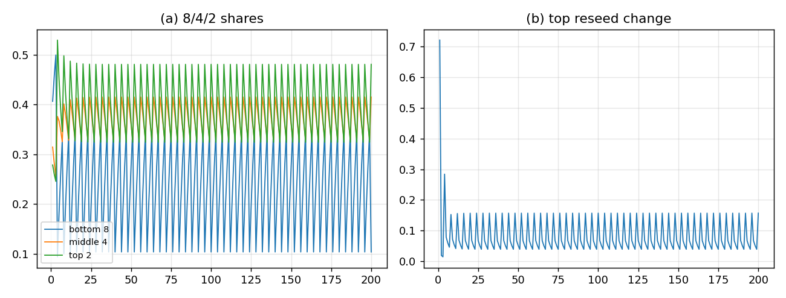

# L=4／D=4 下的层数调整：8/4/2

## 结论

**$L=4$、$D=4$ 不动。** 在 $L=4$ 下 $H=2$，L1-native 的 16 类不成立（最多 $2\times2\times2=8$），所以把层数调整为

$$
\boxed{\;\text{底 }8,\quad \text{中 }4,\quad \text{顶 }2.\;}
$$

毁灭规则保持你原来的**分级模式**：

- 底 8 全灭；
- 中 4 只留最高 $h_*$ 的两个 $\sigma$；
- 顶 2 不动。

结果：**周期 4 仍然出现**，未毁灭的顶继续被 reseed；但顶的份额只有 $0.395$，低于观测粗分组 $0.552$。$L=4$/$D=4$ 全部保住，代价是“底 >10”不再成立（底最多 8）。



## 结构

| L2 层 | $L=4$ 下的类 | 数量 | 毁灭 |
|:--|:--|--:|:--|
| 底 | $(h,\sigma,\pi)$，$h=1,2$ | **8** | 全灭 |
| 中 | $(h,\sigma)$ | **4** | 留最高 $h_*$ 的 2 个 |
| 顶 | $h$ | **2** | 不动 |

- $L=4$ 的 6 个平衡词；$b_h=[4,2]$；$A_h=[3,2]$。
- $\rho$ 由 L1 词类给，push-forward reseed，不设自由 profile。
- 每 $T=4$；$T=L=4$，容量约束也满足（$T\in\{2,4\}$）。
- 四维窗 $q_{\rm rot}(4)=5/9$，在 $(1/2,3/5)$ 内——**$D=4$ 未被触碰**。

## 相位表

| 相位 | 底 8 | 中 4 | 顶 2 |
|:--|--:|--:|--:|
| 1（毁灭后第 1 代） | $0.2000$ | $0.3875$ | $0.4125$ |
| 2 | $0.2800$ | $0.3581$ | $0.3619$ |
| 3 | $0.3487$ | $0.3280$ | $0.3234$ |
| 4（毁灭代） | $0.1035$ | $0.4140$ | $0.4825$ |
| 平均 | $0.2331$ | $0.3719$ | $0.3951$ |

- 底从 $0.104$ 经 $0.200\to0.280\to0.349$ 长回；**逐代 reseed**；
- 中留着的 2 类一直收 seed；毁掉的 2 类从 $\rho$ 长回；
- 顶 2 类每代在变（$0.323$–$0.483$），不是静态；
- 底份额周期 4（FFT bin 50 $=11.5$）。

## 判据（6/6 PASS）

1. $L=4,H=2$，类数 $=8$；
2. 三层 $8/4/2$；
3. $\rho$ 归一；
4. 毁灭代底份额低于中/顶；
5. 未毁顶在变（max 变化 $0.72$）；
6. 底有周期 4 分量。

## 与 16/8/4 的关系

| 方案 | $L$ | 四维窗 | 底数 | 顶（周期平均） | 是否词记录 |
|:--|--:|:--|--:|--:|:--|
| **8/4/2（本方案）** | $4$ | ✅ $5/9$ | $8$ | $0.395$ | ✅ L1 词类 |
| K4 16/8/4（路线 B） | $4$ | ✅ $5/9$ | $16$ | $0.414$ | ❌ 纤维标定 |
| L=8 16/8/4（路线 A） | $8$ | ❌ $19/175$ | $16$ | $0.477$ | ✅ 但放弃 $D=4$ |

**$D=4$ 绝对**时，A 不能选；16/8/4 只剩 K4 纤维方案（B），但它的 profile 是标定的。**8/4/2 是唯一既保 $L=4$、又保真词记录的方案**，代价是底数 8、顶份额偏低。

## 边界

- 这是三层通道 prototype，不是 12 通道忠实引擎；它只验证“L=4 下 8/4/2 的毁灭/reseed 能跑”。
- 顶 $0.395$ vs 观测 $0.552$：分布形状对（顶 > 中 > 底），但定量不够；下一步用 **word-resolved top2 record** 或调整 flow/seed（只控速率，不控分布）。
- 无新量纲锚：$8,4,2$、$\rho$ 都无量纲；$v$ 仍是唯一锚。
- **$L=4$、$D=4$ 未被改动**；这是与 16/8/4 路线的根本区别。

## 复跑

```bash
cd ZeroGPU/src
/usr/bin/python3 zero_l4_layers.py
```

| 文件 | 内容 |
|:--|:--|
| `ZeroGPU/src/zero_l4_layers.py` | $L=4$ 的 8/4/2 分级毁灭/reseed |
| `ZeroGPU/results/zero_l4_layers.json` | $\rho$、每代份额、相位、判据 |
| `ZeroGPU/results/zero_l4_layers.png` | 三层份额与顶 reseed 变化 |

---

*ZeroGPU · L=4 8/4/2 · 2026-10-18*
