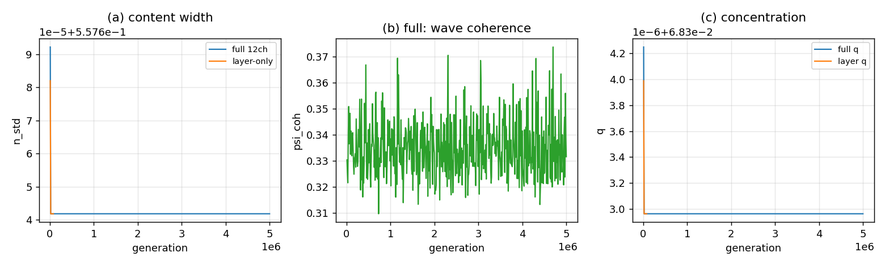

# 忠实引擎长跑审计：形状会冻结，进程不会卡住

## 结论

1. **计算上没有卡住**：全 12 通道引擎跑 $5\times10^6$ 步用 $911.8$ s（$5484$ 步/s），末段仍按同一速度推进；无 NaN、无 $\infty$、无 `record/seed = 0`。
2. **动力学上会冻结**：全引擎的 $n_{std}$、$q$、$h_E$ 在约 $2\times10^4$ 步后到尾段标准差为 $0$／$0$／$1.8\times10^{-15}$；micro-only 的 `persistent` 引擎在 $8\times10^4$ 代被冻结判据抓到（尾段 $n_{std}$、$q$ 的 std 为 $0$）。$5\times10^6$ 步没有迟到逃逸。
3. **全引擎还有一处继续动**：波相位使 $\psi_{\rm coh}$ 在 $0.310$–$0.374$ 间变化；所以严格的“所有监控量都不变”判据说 `ok`，但物质/几何的形状已经冻结。**这是唯一还在动的量；它不产生新结构。**
4. **`record`／`seed` 的绝对值不是物理增长**：在归一化下它们可在 $10^{0}$–$10^{199}$ 间大幅跳（例如 `rec=5.02e199`、`seed=1.90e161`），但形状（$n_{std}$、$q$、$q_{\rm live}$、槽）不变。看形状，不看尺度。



## 设置

| 运行 | 图 | 扇区 | 关键参数 | 步数 | block |
|:--|:--|:--|:--|--:|--:|
| full | cycle16 | 12 通道全开（micro＋几何＋内容＋势＋波＋容量） | $c_h=1.7$，$T=4$，`persistent`，`common` | $5\times10^6$ | $10^4$ |
| layer | cycle16 | 只 micro（`persistent`） | $c_h=0$，波/势关，$T=4$，`common` | $10^7$（到 $8\times10^4$ 冻结） | $10^4$ |

判据（每 block 采样）：非有限值 → `blowup`；`record/seed ≤0` → `underflow`；$n_{std},q,h_E,\psi_{\rm norm},\psi_{\rm coh},q_{\rm live},q_{\rm hist}$ 连续 5 个 block 的相对变化 $<10^{-12}$ → `frozen`；否则 `ok`。

## 结果

| 项 | full（$5\times10^6$） | layer（到 $8\times10^4$） |
|:--|--:|--:|
| wall | $911.8$ s | $10.5$ s |
| 速度 | $5484$ 步/s | $7615$ 步/s |
| 状态 | `ok`（波相位仍在动） | `frozen` |
| 尾段 $n_{std}$ | $0.5576418258138461$（std $0$） | $0.5576418258138465$（std $0$） |
| 尾段 $q$ | $0.06830296233352182$（std $0$） | $0.06830296233352182$（std $0$） |
| 尾段 $h_E$ | $4.14558685915899$（std $1.8\times10^{-15}$） | $0$（几何关） |
| $\psi_{\rm coh}$ | $0.3097$–$0.3737$ | — |
| $q_{\rm live}$／$q_{\rm hist}$ | $0.0625$／$0.0625$（恒定） | $0.333343506$／$0.333343506$（恒定） |
| `record/seed` | 正，归一化下大幅跳 | 正，归一化下大幅跳 |

**冻结时间**：full 的 $n_{std}$、$q$、$h_E$ 在约 $2\times10^4$ 步后进入尾段平台（首块到末块的总变幅分别只有 $5.0\times10^{-5}$、$1.3\times10^{-6}$、$7.2\times10^{-4}$，且都发生在最初的 $2$–$3$ 个 block）；micro-only 在 $8\times10^4$ 代被冻结判据抓到。

**数值健康**：无 NaN／$\infty$；`record`／`seed` 未到 $0$；`psi_norm=1`（酉步精确）；block 速度稳定，无“越跑越慢”。

## 读法

- **“卡住”是形状冻结，不是进程卡住。** 引擎仍在按步推进，但内容/几何/闭合分布都收敛到固定点；`record` 只累积、不产生新形状。更长的时间不会解锁新结构。
- **全引擎的波相位是唯一的持续运动**：$\psi_{\rm coh}$ 随相位转动而变，但 $\psi_{\rm norm}$、$h_E$、$n_{std}$、$q$ 都不变；这是“定态上的相位旋转”，不是新动力学。
- **两层引擎的 $q_{\rm live}$ 不同**（full $0.0625$，layer $0.3333$）不矛盾：full 的几何/容量背景改变了微闭合的分布，但宏观 $n_{std}$、$q$ 相同；这是背景依赖，不是冻结判据的错。
- **要看到新结构，得改条件**：参数（$c_h$、$\alpha$、容量）、初值/噪声、图（path／torus／K4／Heawood），或者接入新的边；单纯加长时间到 $10^7$／$10^8$ 只会重复同一固定点。
- **监控指标的选择**：`record` 的绝对值在归一化下会跳，不能拿它判“有没有新东西”；看 $n_{std}$、$q$、$h_E$、槽、$q_{\rm live}$ 这些**形状量**。

## 复跑

```bash
cd ZeroGPU/src
/usr/bin/python3 zero_long_audit.py --case full  --steps 5000000 --block 10000
/usr/bin/python3 zero_long_audit.py --case layer --steps 10000000 --block 10000
```

| 文件 | 内容 |
|:--|:--|
| `ZeroGPU/src/zero_long_audit.py` | 长跑审计（卡住／冻结／爆掉／下溢／速度） |
| `ZeroGPU/results/zero_long_audit_full.json` | full $5\times10^6$ 的 500 个 block |
| `ZeroGPU/results/zero_long_audit_layer.json` | layer 到冻结的 8 个 block |
| `ZeroGPU/results/zero_long_audit.png` | $n_{std}$、$\psi_{\rm coh}$、$q$ 的长跑图 |

---

*ZeroGPU · 长跑审计 · 2026-10-18*
