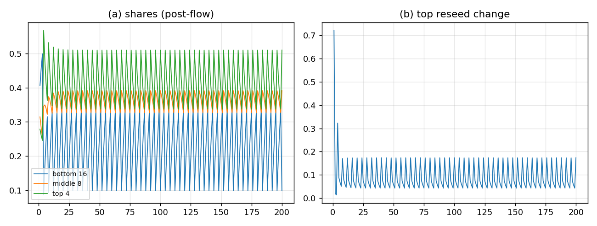

# 由 L1 记录 push-forward 的 16/8/4 reseed

## 结论

把 reseed 从“自由 profile”改成 **L1 记录在 16 个类上的 push-forward** 后，prototype 出现了**真正的周期 4 再播种循环**：

- 底 16 类在每 $T=4$ 全灭，然后在 4 代内被重新播种回来；
- 中 8 类只留最高质量基 $h_*$ 的两类，其余 6 类从 top/L1 的 flow + $\rho$ 重新长；
- 顶 4 类**不毁灭，但每代继续收 L1 seed**（不是静态）；
- 相位平均：底 $0.224$、中 $0.360$、顶 $0.416$（顶 > 中 > 底）；
- 底份额有周期 4（FFT bin 50 $=11.3$）；6/6 结构判据全过。

这是 **推导版 prototype**（三层通道模型），不是忠实走者引擎；但它把“reseed 怎样分”和“L0–L1 怎么影响 reseed”写成了可复算的公式，不再有自由 profile。



## 推导骨架

### L1 的类

取 $L=8$（$H=L/2=4$）。平衡词 $w$ 带：

- 高度 $h(w)=1,\dots,4$；
- 首字母 $\mathbb Z_2$ 符号 $\sigma=\pm$；
- 面积奇偶 $\pi=a(w)\bmod2$。

类为

$$
c=(h,\sigma,\pi),\qquad 4\times2\times2=16 .
$$

L1 记录（这里先用词数，等权）给出

$$
\rho(c)=\frac{\#\{w:c(w)=c\}}{\#W_8}.
\tag{1}
$$

三层就是逐级求和：

$$
\rho_{\rm bottom}(h,\sigma,\pi)=\rho(c),\qquad
\rho_{\rm middle}(h,\sigma)=\sum_\pi\rho(h,\sigma,\pi),\qquad
\rho_{\rm top}(h)=\sum_{\sigma,\pi}\rho(h,\sigma,\pi).
\tag{2}
$$

### 毁灭与再播种

每 $T=4$：

- 底 16 类全清；
- 中只留 $h_*=\arg\max_h\rho_{\rm top}(h)$ 的两个 $\sigma$ 类，清其余 6 类；
- 顶 4 类不动。

**再播种不是重置**：

- 顶每代收 L1 seed；
- 顶→中、中→底的 flow **按 $\rho$ 的目标分布注入**，不按当前（可能为零）的分布；
- 未毁灭的顶/中继续被播种，也继续向下游供给；
- 被毁的底/中从 $\rho$ 的目标质量 + 上游 flow 重新长。

这就是“没毁灭的层怎样重新播种”的答案：**它们不是储层，是通道；每代都收 $\rho$ 的种，再把 $\rho$ 往下游推。**

## 结果（200 代，$T=4$）

| 相位 | 底 16 | 中 8 | 顶 4 |
|:--|--:|--:|--:|
| 1（毁灭后第 1 代） | $0.1911$ | $0.3741$ | $0.4348$ |
| 2 | $0.2698$ | $0.3513$ | $0.3789$ |
| 3 | $0.3383$ | $0.3254$ | $0.3363$ |
| 4（毁灭代） | $0.0975$ | $0.3901$ | $0.5124$ |
| 周期平均 | $0.2242$ | $0.3602$ | $0.4156$ |

- 底在毁灭代掉到 $0.098$，随后 $0.191\to0.270\to0.338$ 长回来；**再播种是逐代完成的**，不是一步重置。
- 中在毁灭代后 $0.39$，随后被顶/底竞争压到 $0.325$，再回升；它留着的 2 类一直收种。
- 顶在毁灭代最高 $0.512$，随后被自身流出和 L1 seed 拉回 $0.34$–$0.43$；它**每代都在变**（最大单代变化 $0.72$，不是静态）。
- 周期 4 在底份额上清楚（FFT bin 50 $=11.3$）。

## L0–L1 各自的作用

| 层 | 作用 | 在本 prototype |
|:--|:--|:--|
| **L0** | 词集/闭合约束、图入射；决定**哪些类可入记录** | 用 $W_8$ 的平衡词集；4 个基来自 $H=4$ |
| **L1** | 高度/$\mathbb Z_2$/面积奇偶标签；记录权重 $\rho$ | 16 类与 $\rho$ 全由 L1 词数据给 |
| **L2** | 只负责清哪些类、按 $\rho$ 长回来 | 毁灭规则 + 下行 flow |

**reseed 的分布不再自由**：它是 (1)–(2) 的 push-forward；$k=0.2$、seed $=0.05$ 只控制**速率**，不控制分布。

## 边界

- **基 4 的来源**：这里用 $L=8$ 的 $H=4$ 个高度层；它与 $K_4$ 的 4 个基顶点是**新的识别**，不是旧定理。若要用 $K_4$ 基，需要另一条“词→K4 顶点”的映射。
- **记录是词数等权**：真实引擎的 L1 `record` 是逐顶点的；要完全按 Z017 的 top2 记录，需要 **word-resolved record**（按 $h,\sigma,a$ 分层）。这是下一步的状态扩展，不是新参数。
- **这是三层通道 prototype**，不是 12 通道忠实走者；它验证的是 reseed 分布和周期 4，不是最终引擎。
- **定量**：相位平均顶 $0.416$ vs 观测粗分组 $0.552$，中偏高、顶偏低；$k$/seed 可调，但**分布形状由 $\rho$ 定**，不是自由 profile。
- **无新量纲锚**：$4,2,2$ 与 $\rho$ 都是无量纲；$v$ 仍是唯一锚。

## 复跑

```bash
cd ZeroGPU/src
/usr/bin/python3 zero_reseed_derivation.py
```

| 文件 | 内容 |
|:--|:--|
| `ZeroGPU/src/zero_reseed_derivation.py` | L1 类 $\rho$ + 16/8/4 push-forward reseed prototype |
| `ZeroGPU/results/zero_reseed_derivation.json` | $\rho$、每代份额、判据 |
| `ZeroGPU/results/zero_reseed_derivation.png` | 三层份额与顶 reseed 变化 |

---

*ZeroGPU · L1 push-forward reseed · 2026-10-18*
