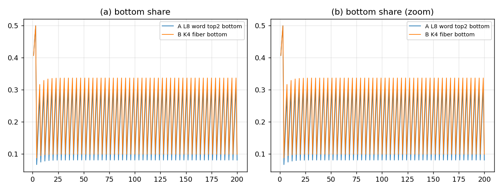

# 16/8/4 两条路线 A/B 的对比

## 结论

两条路线都能跑出**周期 4**，都能让未毁灭的层继续被 reseed；但**A（L=8 词类 top2）明显更接近观测粗分组**：

| 路线 | 底/中/顶（周期平均） | 到观测粗分组的 L1 距离 | 底周期 4 幅度 |
|:--|:--|--:|--:|
| **A：L=8 词类 top2** | $0.1978/0.3255/0.4766$ | **$0.1502$** | $10.718$ |
| **B：K4 4 基 × 纤维** | $0.2249/0.3611/0.4140$ | $0.2754$ | $11.347$ |
| 观测粗分组 | $0.1724/0.2759/0.5517$ | — | — |

A 的顶更高、中更低，方向更对；B 的中偏高、顶偏低。两条都没有精确复现，但 A 是更值得继续的路线。



## 两条路线

### A：$L=8$，词类 $(h,\sigma,\pi)$

- $H=4$；16 类 $=4\times2\times2$；
- 每类保留 **top2 词**（按面积、字典序），$\rho$ 由这些词数给；
- 顶/中/底 = 对 $\pi$、$(\sigma,\pi)$ 求和；
- reseed 用 $\rho$ 的 push-forward；毁灭：底全灭、中留最高 $h_*$ 的两类、顶不动。

**优点**：真词层；16 类有来源；reseed 分布由记录给。
**代价**：$L=8$，与 Z062 的 $L=4$ 锁定冲突；top2 目前是“每类 top2 词”，不是严格的“最近两代记录”。

### B：$L=4$，$K_4$ 4 基 × 纤维

- 4 个 $K_4$ 基顶点 × 4 纤维槽；16/8/4 = 每基 4/2/1 槽；
- 记录取 $K_4$ 顶点记录 $[0.5517,0.2759,0.1034,0.069]$，按观测粗分组标定纤维 profile；
- reseed/毁灭规则同 A。

**优点**：$L=4$ 不动；与忠实引擎的基一致。
**代价**：16 类的“纤维标签”是**标定的 profile**，不是词记录；物理推导弱。

## 相位表（A）

| 相位 | 底 | 中 | 顶 |
|:--|--:|--:|--:|
| 1（毁灭后第 1 代） | $0.1646$ | $0.3343$ | $0.5011$ |
| 2 | $0.2395$ | $0.3311$ | $0.4294$ |
| 3 | $0.3075$ | $0.3177$ | $0.3748$ |
| 4（毁灭代） | $0.0798$ | $0.3191$ | $0.6011$ |
| 平均 | $0.1978$ | $0.3255$ | $0.4766$ |

底在 4 代内从 $0.080$ 长回 $0.308$；顶每代在 $0.375$–$0.601$ 间变（被 reseed，不是静态）。

## 判据（5/5 PASS）

1. A/B 都是 16 类 $(4,2,2)$；
2. 两者的 $\rho$ 归一；
3. 两者都有周期 4；
4. 未毁灭的顶都在变；
5. A 到观测粗分组的距离小于 B。

## 边界

- 这是**三层通道 prototype**，不是 12 通道忠实引擎；它比较的是 **reseed 分布 + 毁灭** 的后果。
- A 的 $L=8$ 与 Z062 的 $L=4$ 锁定冲突；B 的 profile 是标定的，不是推导的。**两条都还不是“证明”，只是路线筛选。**
- A 的 top2 是“每类 top2 词”，不是 Z017 的“最近两代记录”；真正的 word-resolved top2 需要动态词记录，下一步再做。
- 无新量纲锚：$4,2,2$、$\rho$、profile 都无量纲；$v$ 仍是唯一锚。

## 复跑

```bash
cd ZeroGPU/src
/usr/bin/python3 zero_routes_compare.py
```

| 文件 | 内容 |
|:--|:--|
| `ZeroGPU/src/zero_routes_compare.py` | A/B 两条 $\rho$ 与同一 push-forward 模型 |
| `ZeroGPU/results/zero_routes_compare.json` | 两条的每代份额、相位平均、距离、判据 |
| `ZeroGPU/results/zero_routes_compare.png` | 两条底份额的周期 4 对比 |

---

*ZeroGPU · A/B 路线对比 · 2026-10-18*
