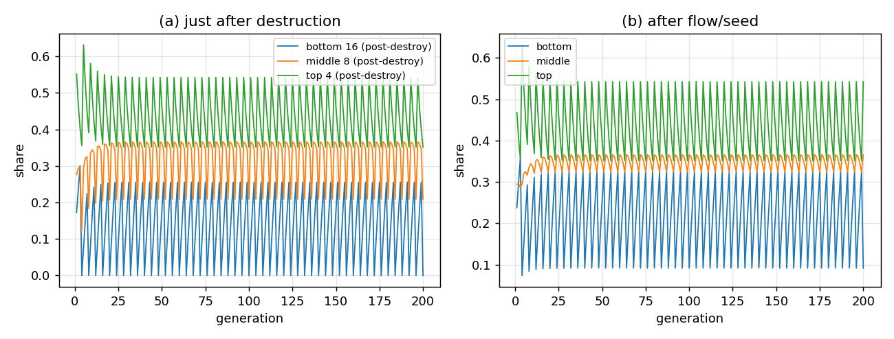

# L2 亚亚层分级毁灭：16/8/4 的 prototype

## 结论

按“底 16／中 8／顶 4，毁灭时底全灭、中只留最上面 2 个、顶不动”的规则，prototype 进入**周期 4 的分级毁灭循环**：

- **底**：每次毁灭后份额 $0$；随后被下行流/seed 补回；
- **中**：毁灭后只剩最上面 2 个亚亚层（活跃数 $2/8$），总份额从 $0.3241$ 掉到 $0.2089$；
- **顶**：$4/4$ 不动，份额在毁灭瞬间不变；
- 没有 NaN、没有负值、没有锁死；尾段是一个稳定的周期 4。



这是**层级 prototype**，不是忠实 4 顶点走者引擎：它验证的是“16/8/4 + 分级毁灭”这条规则**能**产生周期 4 的“全灭／半灭／不动”信号；定量份额由流/seed/profile 参数决定，尚未与忠实引擎对齐。

## 结构

| L2 亚层 | 亚亚层数 | 毁灭规则 | 毁灭后活跃 |
|:--|--:|:--|--:|
| 底 | 16 | 全灭 | 0 |
| 中 | 8 | 只留最上面 2 个 | 2 |
| 顶 | 4 | 不动 | 4 |

- 每层用**有序亚亚层通道**表示；通道权重之和 = 该层总量。
- 层间有下行流 顶→中→底；顶部有 L1 seed；底部是汇；总量归一化到 1。
- 毁灭每 $T=4$ 代一次，在流/seed **之前**执行；因此“毁灭后”和“流/seed 后”分开记录。
- 亚亚层内部分布用几何 profile（默认 $r=0.8$，越靠上越重）；`r=1` 是均匀对照。
- 初值用观测 L2 的粗分组：底 $p_2+p_3=0.1724$、中 $p_1=0.2759$、顶 $p_0=0.5517$。

## 结果

默认参数（$T=4$、$r=0.8$、$k=0.2$、seed $=0.05$，200 代）：

| 时刻 | 底 | 中 | 顶 |
|:--|--:|--:|--:|
| 毁灭前（每周期） | $0.3243$ | $0.3241$ | $0.3515$ |
| 毁灭后 | $0$ | $0.2089$ | $0.3515$ |
| 流/seed 后 | $0.0915$ | $0.3659$ | $0.5426$ |
| 尾段平均（流/seed 后） | $0.2122$ | $0.3493$ | $0.4385$ |

**读法**：

- 底每次被完全清零，随后在 4 代内被补到 $\sim0.09$（流/seed 后）；下一个周期再次清零。
- 中只保留最上面 2 个通道；由于 profile 上重下轻，损失的是较重的下半段，所以总量掉到 $0.2089$（不是简单的 $2/8$）。
- 顶 4 个通道完全不动，毁灭瞬间份额不变；之后只受流入/流出影响。
- 周期 4 是**规则给的**，不是数值噪声；它和全局毁灭的“归一化锁死”形成对照。

## 判据（6/6 PASS）

1. 亚亚层数 $=16/8/4$；
2. 每次毁灭底总 $=0$；
3. 每次毁灭中活跃 $=2$；
4. 每次毁灭顶活跃 $=4$ 且总不变；
5. 毁灭后流/seed 恢复，有限、非负；
6. 毁灭事件严格每 $T=4$。

## 边界

- 这是**规则 prototype**：流、seed、profile 的形状是探索性无量纲选择，不是从公理导出的；定量份额会随参数变。
- 16/8/4 与“中留 2”是**新的具名输入**（用户定的层级），不是 Z129/Z022 的旧结论；Z129 §8 的“亚亚层终止”只对旧的全局毁灭结构成立。
- 没有新量纲锚：16/8/4、2、$T=4$ 都是整数；$v$ 仍是唯一量纲锚，$c/m_e/\hbar$ 不用。
- 还没有映射到忠实 4 顶点走者：要把 16/8/4 通道接到 4 个顶点占据/3 个槽上，需要一条新的“通道→顶点”权重映射；这是下一步，不是本 prototype 的结论。
- 若把参数调到别的区域，底/中/顶的定量份额会变；但“底全灭、中留 2、顶不动”的**结构性周期 4**不会变。

## 复跑

```bash
cd ZeroGPU/src
/usr/bin/python3 zero_sublayers.py --steps 200 --T 4 --r 0.8 --k 0.2 --seed 0.05
```

| 文件 | 内容 |
|:--|:--|
| `ZeroGPU/src/zero_sublayers.py` | 16/8/4 分级毁灭 prototype |
| `ZeroGPU/results/zero_sublayers.json` | 每代 pre／post-destroy／post-flow 与判据 |
| `ZeroGPU/results/zero_sublayers.png` | 毁灭后／流后 的三层份额 |

---

*ZeroGPU · 亚亚层 prototype · 2026-10-18*
