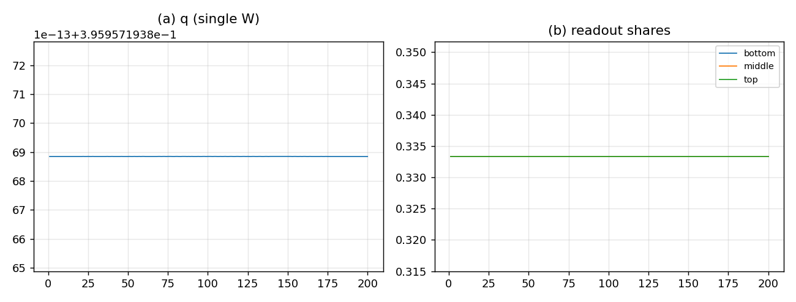

# A 判定：单份 $W$ 的 16/8/4 读出——自洽但退化

## 结论

按 A（放弃“顶不动”，16/8/4 作为同一 $W$ 的三分辨率读出）跑 200 代，**判定为不成立**：

| 量 | 结果 | 目标 |
|:--|:--|:--|
| 尾段三层份额 | $[0.3333,0.3333,0.3333]$ | $[0.1724,0.2759,0.5517]$ |
| 到观测距离 | $0.4367$ | — |
| $q$ 均值 | $0.395957$ | $\approx0.0683$ |
| 周期 4 | **无**（bin 50 $=1.0\times10^{-15}$） | 应有 |
| 无 NaN | 是 | — |

**单份 $W$ 下，底/中/顶都是同一个 $W$ 的求和，三层的总质量恒等**，所以份额只能是 $1/3$；$q$ 锁在 $K_4$ 的 $0.395957$；连周期 4 都没有。**A 把要解释的现象一起删掉了。**



## A 做了什么

- 只有一份底层 $W$（$4\times4$，16 类）；
- 底 16 = $W$ 的 16 项；中 8 = 对 $\pi$ 求和；顶 4 = 对 $\sigma,\pi$ 求和；
- 毁灭只作用底层：$T=4$ 时 $W$ 全灭；中/顶是读出，跟着底层走；
- record 从 $W$ 的对角读；$1:2:4$ 此时自动一致（$x=W$）。

## 为什么退化

- 三层的**总质量是同一个 $\sum W$**：底 $=\sum W$，中 $=\sum W$，顶 $=\sum W$；
- 归一化后必然 $[1/3,1/3,1/3]$，与 $W$ 的分布无关；
- 没有独立的中/顶储层，就没有“中留 2、顶不动”的分级结构；
- 全局毁灭 + top2 seed 让 $q$ 锁死在 $K_4$ 的 seed 锁定值，周期 4 也消失。

## 合并判定：A 与 B 都失败

| 路线 | 一致性 | 层级份额 | 权重 | $q$ | 周期 4 |
|:--|:--|:--|:--|:--|:--|
| **A：单 W 读出** | ✅ 聚合一致 | ❌ 恒 $1/3$ | $1:2:4$ 自洽 | $0.396$ | ❌ |
| **B：独立 + 驻留** | ❌ 不满足聚合 | ✅ 有独立质量 | ❌ 不稳（relstd 0.36） | $0.456$ | ✅ |
| 原始 raw 和 | ❌ 无依据 | ✅ $[0.170,0.292,0.537]$ | ❌ 自由 | $0.313$ | ✅ |
| 观测 | — | $[0.172,0.276,0.552]$ | — | $0.068$ | — |

**A 保住了数学自洽，丢掉了现象；B 保住了现象，权重不稳；raw 和有现象，但权重无依据。三者都不成立。**

## 这说明什么

- **“三份独立 + 顶不动”不是聚合读数**：它需要独立的中/顶储层，否则份额恒 $1/3$。
- **但独立储层 + 当前 flow 又没有稳定权重**：中吸走质量，顶饿死。
- 所以缺的不是“加权公式”，而是一个**能同时保住独立层级和稳定质量分布的动力学**；现有 flow（顶→中→底、固定 $k$）不够。

## 下一步：C（新结构）

两条可行方向，都必须单独推导，不能拍：

1. **闭环 flow + 反馈**：让底/中按某个守恒量反馈回顶，使三份质量有稳定驻留；反馈系数由守恒/聚合约束定，不是自由参数。
2. **约束型三拷贝**：保留独立储层，但每代施加“聚合一致性”软约束（拉回 $W_m\approx A_mW_b$、$W_t\approx A_tW_b$），在“独立”与“聚合”之间取一个由约束强度决定的中间态；约束强度也要有来源。

**在 C 没做出来之前，16/8/4 的层级份额不能当作“已复现”**；A/B 的失败已经把边界划清：要么独立但动力学不稳，要么自洽但退化。

## 复跑

```bash
cd ZeroGPU/src
/usr/bin/python3 zero_window16_A.py
```

| 文件 | 内容 |
|:--|:--|
| `ZeroGPU/src/zero_window16_A.py` | 单份 $W$ 的 16/8/4 读出 |
| `ZeroGPU/results/zero_window16_A.json` | 每代份额、$q$、判据 |
| `ZeroGPU/results/zero_window16_A.png` | $q$ 与三层读出份额 |

---

*ZeroGPU · A 判定 · 2026-10-18*
