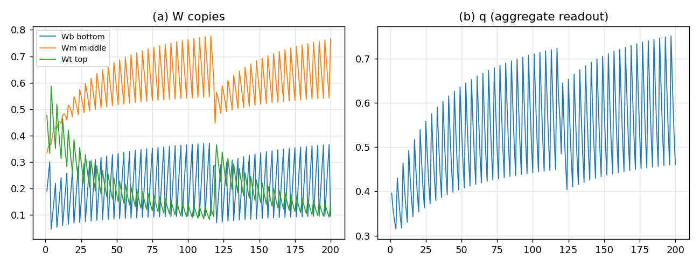

# 聚合一致读法的审计：$1:2:4$ 不救 $q$，且暴露一个矛盾

## 结论

按“聚合一致最小二乘”把 record 改成

$$
x=\frac13\Bigl(W_b+A_m^{\mathsf T}W_m+A_t^{\mathsf T}W_t\Bigr),
\qquad
R_j=\frac13\bigl(R^{(b)}_j+2R^{(m)}_j+4R^{(t)}_j\bigr)
$$

后，**没有复现观测**，反而更差：

| 读法 | 尾段底/中/顶 | $q$ 均值 | 到观测距离 |
|:--|:--|--:|--:|
| 原始 $W$ 总量（上一版） | $[0.1703,0.2922,0.5374]$ | $0.3127$ | $0.0327$ |
| **聚合一致 $1:2:4$（本版）** | $[0.2302,0.6464,0.1234]$ | $0.5317$ | $0.857$ |
| 观测粗分组 | $[0.1724,0.2759,0.5517]$ | $\approx0.068$ | — |

**中拷贝独大、顶被压到 $0.12$，$q$ 反而升到 $0.53$。** 上一版的 $0.0327$ 是用**原始 $W$ 总量**量的，不是这个推导读法；换成推导读法后，那个“最好”不成立。



## 推导本身没错

- $16$ 类 $(j,\sigma,\pi)$；中 $8$ 对 $\pi$ 求和，顶 $4$ 对 $\sigma,\pi$ 求和；
- 等可靠性最小二乘给 $x=(W_b+A_m^{\mathsf T}W_m+A_t^{\mathsf T}W_t)/3$；
- site 记录权重 $1:2:4$，来自聚合重数（中每类含 2 个 $\pi$，顶每类含 4 个）；
- 这一步是**唯一**的，不是拍的。

**问题不在权重，在“三份拷贝是什么”。**

## 暴露的矛盾

### 读法 A：三层是同一个 $W$ 的聚合

若 $W_m=A_m W_b$、$W_t=A_t W_b$，则：

- 底 $W_b$ 全灭 $\Rightarrow$ $W_m,W_t$ 也全灭；
- 顶与“不动”不相容；
- 16/8/4 只能是**同一 $W$ 的三个读出分辨率**，不是三份独立储层。

### 读法 B：三层是三份独立储层

若顶真的“不动”、底真的“全灭”，则 $W_m,W_t$ **不是** $W_b$ 的聚合：

- 它们不满足 $W_m=A_m W_b$；
- 那么 $1:2:4$ 的聚合权重**没有依据**；
- 权重只能来自**动力学**（flow/停留时间/质量），不是聚合重数。

**二者不能同时成立。** 当前三拷贝引擎是 B（独立 + 顶不动），却用了 A 的权重，所以中拷贝被过度加权、顶被压死。

## 这意味着什么

- **“record 从三份加权和读”本身需要一个前提**：三份是同一量的测量，还是三个独立储层？
  - 同一量的测量 → $1:2:4$，但顶不能独立不动；
  - 三个独立储层 → 没有固定聚合权重，权重必须由 flow 决定。
- 上一版 $[0.170,0.292,0.537]$ 是**原始 W 总量**，不是任何推导读法；它不能当作“层级复现”的证据。
- $q$ 偏高（$0.53$）进一步说明：三份独立储层的**内容集中度**与观测不符，不是换个读法能修的。

## 下一步（二选一，不能再混）

**A. 放弃“顶不动”**：承认 16/8/4 是同一 $W$ 的三分辨率读出；毁灭只作用在底层 $W_b$，中/顶是读出，跟着底层走。这样 $1:2:4$ 有权重依据，但“顶不动”这条规则要删掉。

**B. 保留“顶不动”**：承认三份是独立储层；放弃聚合权重，改从 **flow 的停留时间/质量** 推导每份在 record 中的权重：
$$
w_c \propto \text{该拷贝的驻留质量/停留时间},
$$
由 $T=4$、$k$、seed 份额决定，而不是 $1:2:4$。

**我建议先做 B 的判定**：因为“底全灭、顶不动”是你最初的分级毁灭假设；如果它是硬的，A 就不成立，权重只能走动力学。若 B 推不出稳定权重，再退回 A，删掉“顶不动”。

## 复跑

```bash
cd ZeroGPU/src
/usr/bin/python3 zero_window16_aggregate.py
```

| 文件 | 内容 |
|:--|:--|
| `ZeroGPU/src/zero_window16_aggregate.py` | 聚合一致读法 + 三拷贝 flow |
| `ZeroGPU/results/zero_window16_aggregate.json` | 每代份额、$q$、判据 |
| `ZeroGPU/results/zero_window16_aggregate.png` | 三拷贝份额与 $q$ |

---

*ZeroGPU · 聚合读法审计 · 2026-10-18*
