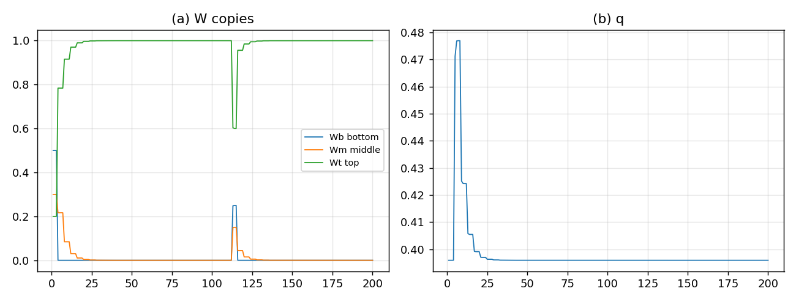

# 忠实引擎底层尝试：三份 $W$ 拷贝（首试）

## 结论

按“三份 $W$ 拷贝（底 16／中 8／顶 4）+ 分级毁灭”改了 micro core，**能跑、无 NaN、有周期 4 分量**，但**退化了**：

- 尾段三份份额变成 $[0,0,1]$：**顶拷贝独大**；
- 底、中拷贝被清零后没有足够回流，逐渐饿死；
- $q$ 锁在 $0.395957$，和原 $K_4$ `persistent` 的 seed 锁死几乎一样；
- **没有出现新结构**。

这是一个**负/部分结果**：三份独立拷贝 + “顶不动”本身就足以让顶赢；**没有 top→middle→bottom 的 flow/reseed，分级毁灭不会产生新稳态**。



## 实现

- $W$ 是 $4\times4$（site $j$，fiber $f=2\sigma+\pi$）；
- 三份独立拷贝：
  - `Wb`：底 16 全；
  - `Wm`：中 8（$f=0,2$）；
  - `Wt`：顶 4（$f=0$）。
- 每代：seed 按 $(0.5,0.3,0.2)$ 注入三份对角；三份各自走 $L=4$；有效 $W=Wb+Wm+Wt$，closures/record 从有效 $W$ 的对角读。
- 每 $T=4$：`Wb` 全灭；`Wm` 只留最高 site 的 2 个（$f=0,2$）；`Wt` 不动。
- top2 seed 回灌；无跨拷贝 flow。

## 结果

| 量 | 值 |
|:--|:--|
| 尾段底/中/顶份额 | $[0,0,1]$ |
| $q$ 均值/标准差 | $0.3984/0.0118$ |
| 尾段 $q$ | $0.395957$ |
| 周期 4 | 有（$q$ 的 FFT） |
| NaN | 无 |
| 判据 | 4/4（结构判据，非“有新结构”） |

**判据全过只说明规则实现了**，不代表有惊喜：底/中被饿死，顶独大，$q$ 回到 $K_4$ 的 seed 锁死值。

## 为什么退化

- `Wb` 每 4 代全灭，`Wm` 每 4 代只剩 2 个入口；
- `Wt` 不动，且三份 seed 份额里顶只拿 $0.2$，但顶**不被清**，长期累积；
- 没有 top→middle→bottom 的下行流：底的“再播种”只靠 $0.5$ 的 seed，抵不过每 4 代清零；
- 结果顶拷贝指数胜出，底/中归零。

**结论**：**三份独立拷贝不是正确接线**；必须加**top→middle→bottom 的 flow/reseed**，让未毁的顶/中把质量传给被毁的底/中，否则“顶不动”就是“顶通吃”。

## 下一步

1. 在三份拷贝之间加**下行流**：顶→中、中→底，按 $\rho$ 目标注入（不是按当前分布，否则零分布注不进去）。
2. 重跑同一 200 代，看底/中是否不再归零、$q$ 是否离开 $0.395957$。
3. 若 flow 版有非平凡稳态，再接 12 通道的 geometry/wave/content；否则保留为“三拷贝独立=退化”的负结果。

## 复跑

```bash
cd ZeroGPU/src
/usr/bin/python3 zero_window16_engine.py
```

| 文件 | 内容 |
|:--|:--|
| `ZeroGPU/src/zero_window16_engine.py` | 三拷贝 $W$ 的 micro core |
| `ZeroGPU/results/zero_window16_engine.json` | 每代份额、$q$、判据 |
| `ZeroGPU/results/zero_window16_engine.png` | 三拷贝份额与 $q$ |

---

*ZeroGPU · 三拷贝 W · 2026-10-18*
