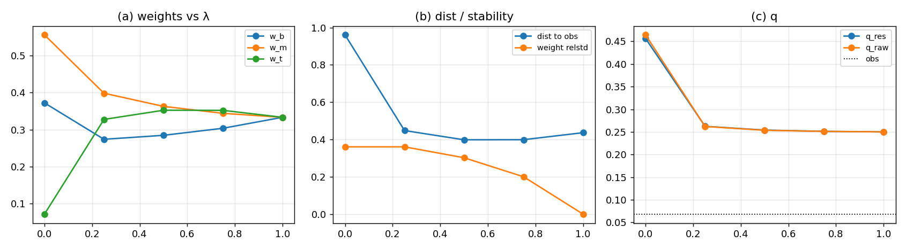

# A/B 合并：软约束扫描——没有甜点

## 结论

把 A（聚合一致）和 B（独立三拷贝）用软约束

$$
W_m\leftarrow(1-\lambda)W_m+\lambda\,\mathcal A_m(W_b),\qquad
W_t\leftarrow(1-\lambda)W_t+\lambda\,\mathcal A_t(W_b)
$$

连起来，扫 $\lambda\in\{0,0.25,0.5,0.75,1\}$：**没有 $\lambda$ 同时满足“权重稳定”和“层级接近观测”**。

| $\lambda$ | $w_b/w_m/w_t$ | 权重 relstd | $q_{\rm res}$ | 到观测距离 |
|--:|:--|--:|--:|--:|
| $0$（B） | $[0.3724,0.5564,0.0713]$ | $0.361$ | $0.4564$ | $0.961$ |
| $0.25$ | $[0.2738,0.3985,0.3276]$ | $0.361$ | $0.2623$ | $0.448$ |
| $0.50$ | $[0.2846,0.3629,0.3524]$ | $0.302$ | $0.2540$ | $0.399$ |
| $0.75$ | $[0.3037,0.3441,0.3522]$ | $0.200$ | $0.2512$ | $0.399$ |
| $1$（A） | $[0.3333,0.3333,0.3333]$ | $0.000$ | $0.2500$ | $0.437$ |
| 观测 | $[0.1724,0.2759,0.5517]$ | — | $\approx0.068$ | — |

- $\lambda=0$ 是 B：层级有一点（顶只有 $0.071$），但权重不稳；
- $\lambda=1$ 是 A：权重完全稳定，但份额恒 $1/3$；
- 中间 $\lambda$：$q$ 从 $0.456$ 降到 $0.25$（比 B 好），但**份额离观测仍 $0.40$**；顶始终上不到 $0.55$。

**判据 4/5**：无 NaN、$\lambda=0$ 对 B、$\lambda=1$ 对 A、存在稳定权重（只有 $\lambda=1$）——但“存在 $\lambda$ 使份额接近观测”**FAIL**。



## 为什么没有甜点

- 软约束把中/顶拉向**底的聚合**；$\lambda$ 越大，顶越接近“底的 1/4”，顶份额被压向 $1/3$。
- 观测要的是**顶 $0.55$**，即顶必须**独立地重**；约束方向正好相反。
- $\lambda$ 只是把“不稳但顶略重”连续变成“稳定但三等分”；目标点不在 A–B 线段上。

## 判定

- **A/B 合并失败**：不存在 $\lambda$ 同时给稳定权重和观测层级。
- 中间 $\lambda$ 的 $q=0.25$ 是**改善**（B $0.456$、A $0.396$），但份额不对；不能算复现。
- 目标层级在 A–B 线段**之外**；需要**顶偏置**的新机制，而不是在 A/B 之间插值。

## 下一步：C′（顶偏置）

两条方向，仍需推导：

1. **只约束中、不约束顶**：让顶保持独立储层，软约束只作用在中层；顶通过 flow 反馈回中/底。这样顶不被压成 $1/4$。
2. **顶的独立源**：给顶一个不来自底的 seed/记录项（例如 L1 的 top2 记录直接进顶），使顶在约束下仍能维持高份额；该项要有来源，不能自由加。

**在 C′ 之前，16/8/4 的观测层级仍不能算“已复现”**；A/B 合并只是把失败边界画得更清楚。

## 复跑

```bash
cd ZeroGPU/src
/usr/bin/python3 zero_window16_merge.py
```

| 文件 | 内容 |
|:--|:--|
| `ZeroGPU/src/zero_window16_merge.py` | A/B 软约束扫描 |
| `ZeroGPU/results/zero_window16_merge.json` | 各 $\lambda$ 的权重、$q$、距离、判据 |
| `ZeroGPU/results/zero_window16_merge.png` | 权重/距离/$q$ 随 $\lambda$ |

---

*ZeroGPU · A/B 合并 · 2026-10-18*
