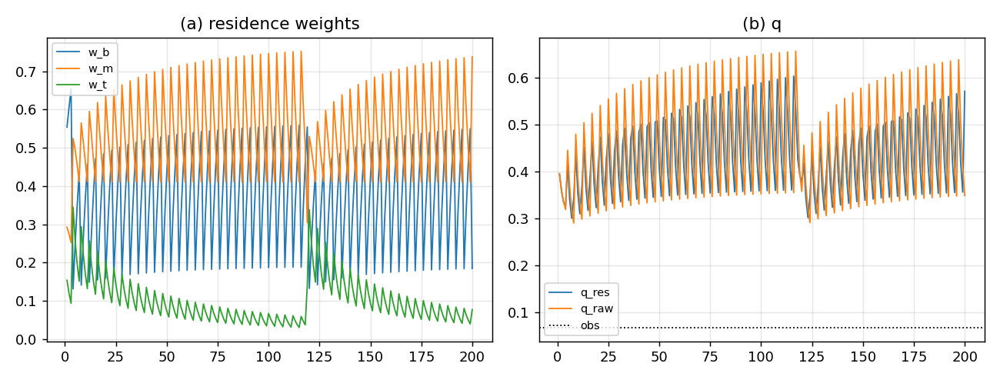

# B 判定：独立三拷贝 + 驻留权重——不稳定，不成立

## 结论

按 B 的路线（三份独立 $W$、顶不动、放弃 $1:2:4$、权重由 flow 的驻留质量给）跑 200 代后，**判定为不成立**：

| 量 | 结果 | 判据 |
|:--|:--|:--|
| 驻留权重 $w_b/w_m/w_t$（尾段均值） | $[0.3724,0.5564,0.0713]$ | — |
| 权重的相对涨落 | $[0.361,0.210,0.283]$ | 要求 $<0.1$，**FAIL** |
| $q_{\rm res}$（驻留加权） | $0.4564$ | 目标 $\approx0.0683$ |
| $q_{\rm raw}$（原始和） | $0.4643$ | 目标 $\approx0.0683$ |
| 周期 4 | 有 | PASS |
| 无 NaN | 是 | PASS |

**权重不稳定**：底/中/顶的驻留质量在尾段仍漂移（中 $0.556$、顶只有 $0.071$）；$q$ 仍是 $0.46$，离观测 $0.068$ 很远。B 不能提供稳定的权重，**不成立**。



## B 的做法

- 三份独立 $W$：底 16、中 8、顶 4；
- 每 $T=4$：底全灭；中留最高 site；顶不动；
- flow 顶→中→底，按 $\rho$ 目标注入；
- record 不取固定 $1:2:4$，而取**驻留质量加权**：
  $$
  R=\frac{m_b r_b+m_m r_m+m_t r_t}{m_b+m_m+m_t},
  $$
  其中 $m_c$ 是该拷贝当代的质量，$r_c$ 是其归一化记录；
- 最近 40 代的时间平均给 $w_c$。

## 为什么失败

- **中拷贝吸走质量**：顶每代被 flow 抽走 $0.2$，中只被抽 $0.2$ 但持续收到顶的注入；中质量涨到 $0.556$，顶跌到 $0.071$。
- **没有稳定驻留**：尾段权重仍有 $21\%$–$36\%$ 的相对涨落；“驻留权重”本身随时间漂，不能当固定权重。
- **$q$ 不降**：$q_{\rm res}\approx q_{\rm raw}\approx0.46$，说明驻留加权没有改变内容集中度；问题在动力学，不在读法。

## 判定

- **B 不成立**：独立三拷贝 + 顶不动 + flow 不产生稳定驻留权重；权重是漂的，$q$ 也不对。
- **不能靠“驻留质量”给三个独立储层一个固定权重**；要么改动力学让质量分布稳定，要么退回 A（放弃顶不动）。

## 下一步

B 失败后，只剩两条：

1. **A：放弃“顶不动”**，把 16/8/4 当作同一 $W$ 的三分辨率读出；毁灭只作用底层 $W_b$，中/顶是读出。这样 $1:2:4$ 有权重依据，但“顶不动”要删。
2. **改 flow 让质量稳定**：例如把顶的流出改成“只输出超出目标的部分”，或让中/底的注入反馈回顶；但这是新的动力学输入，需要单独推导，不是 B 的原样。

**我建议走 A**：B 的失败说明“三份独立 + 顶不动”与稳定权重不相容；A 至少在数学上自洽（聚合读数），代价是删掉“顶不动”这条规则。

## 复跑

```bash
cd ZeroGPU/src
/usr/bin/python3 zero_window16_residence.py
```

| 文件 | 内容 |
|:--|:--|
| `ZeroGPU/src/zero_window16_residence.py` | 三拷贝独立 + 驻留权重 B 判定 |
| `ZeroGPU/results/zero_window16_residence.json` | 权重、$q$、判据 |
| `ZeroGPU/results/zero_window16_residence.png` | 驻留权重与 $q$ |

---

*ZeroGPU · B 判定 · 2026-10-18*
