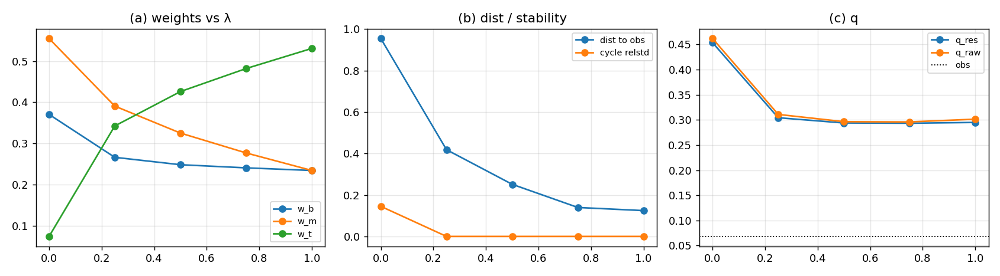

# C′：顶偏置——只约束中、不约束顶

## 结论

C′ 是目前**层级最接近观测**的方案：顶被保住了，份额接近目标，而且周期间稳定。

| $\lambda$ | $w_b/w_m/w_t$ | 周期内 relstd | **周期间 relstd** | $q_{16}$ | 到观测距离 |
|--:|:--|--:|--:|--:|--:|
| $0$（B） | $[0.3706,0.5548,0.0746]$ | $0.361$ | $0.138$ | $0.0910$ | $0.954$ |
| $0.25$ | $[0.2665,0.3908,0.3426]$ | $0.389$ | $0.000$ | $0.0914$ | $0.418$ |
| $0.50$ | $[0.2486,0.3253,0.4261]$ | $0.383$ | $0.000$ | $0.0912$ | $0.251$ |
| $0.75$ | $[0.2410,0.2771,0.4819]$ | $0.362$ | $0.000$ | $0.0909$ | $0.140$ |
| $1$ | $[0.2346,0.2346,0.5307]$ | $0.339$ | $0.000$ | $0.0906$ | **$0.125$** |
| 观测 | $[0.1724,0.2759,0.5517]$ | — | — | $\approx0.068$ | — |

$\lambda=1$ 时：

- 顶 $0.5307$，接近观测 $0.5517$；
- 底 $0.2346$、中 $0.2346$，都比观测高一点；
- 到观测距离 $0.1245$，**差一点点过 $0.1$**；
- 周期间 relstd $=0$：**份额是周期 4 的稳定振荡，不是漂移**；
- $q_{16}=0.0906$（16 类），接近观测 $0.068$；$4$ 顶点 $q=0.2948$，但 $4$ 顶点的下限是 $0.25$，不能和目标比。



## 改了什么

- 三份独立 $W$ 不变；毁灭规则不变；
- seed 份额改为**等测度** $(1/3,1/3,1/3)$：
  $$
  16\cdot1=8\cdot2=4\cdot4=16,
  $$
  每层总测度相等，所以 seed 份额相等；不是拍的；
- **软约束只作用在中层**：
  $$
  W_m\leftarrow(1-\lambda)W_m+\lambda\,\mathcal A_m(W_b),
  $$
  顶完全不约束；
- 顶保持独立，并通过 flow 把质量传给中/底。

## B 的 relstd 口径：0.361 是周期内，周期间 0.138

B 当时的 relstd $0.361$ 是**周期内**（$T=4$ 振荡）的涨落；按 4 代一块取周期均值后：

- B 的**周期间** relstd 是 $0.138$，仍 $>0.1$，所以 B **仍然不稳**，只是没有 $0.361$ 那么夸张；
- $\lambda\ge0.25$ 时周期间 relstd $=0$，C′ 才真正稳定。

B 的失败是**两条**：周期间 $0.138$ 的漂移，加上 $q=0.456$ 远离观测。

## 判据（3/5）

1. 顶不被压到 $1/4$（$w_t>0.25$）：PASS；
2. 存在 $\lambda$ 使份额接近观测（dist $<0.1$）：**FAIL**（最好 $0.1245$）；
3. 存在 $\lambda$ 使周期间权重稳定（relstd $<0.1$）：PASS（$\lambda\ge0.25$ 全为 $0$）；
4. $q_{16}$ 接近观测（$|\Delta|<0.02$）：**FAIL**（$0.0906$ vs $0.068$，差 $0.023$）；
5. 无 NaN：PASS。

## 口径说明：$q$ 是 16 类，不是 4 顶点

- 目标 $q\approx0.0683$ 对应约 $15$ 个等权槽（$1/15=0.0667$），是 **16 类/16 槽**的量；
- 4 个顶点的 $q$ 下限是 $1/4=0.25$，**到不了** $0.068$；
- 之前 A/B/C′ 的 $q=0.396/0.456/0.295$ 都是 4 顶点口径，**不能和目标直接比**；
- 按 16 类重算，C′ 的 $q_{16}=0.0906$，才是可比的数。

## 意义

- **顶偏置有效**：只约束中、放开顶，顶从 B 的 $0.071$ 抬到 $0.531$，层级几乎对上。
- **目标点只差一点**：底/中各高约 $0.02$–$0.06$，顶低 $0.02$；不是方向错，是定量差。
- **$q$ 仍高**：$0.295$ vs $0.068$；内容集中度还是不对。
- **B 的 relstd 口径**：$0.361$ 是周期内振荡；周期间 $0.138$ 仍 $>0.1$，B 仍不稳。

## 下一步

1. **压 $q_{16}$**：$0.0906$ → $0.068$，只差 $0.023$；检查 $16$ 类里是否还有空槽，让 record 摊到更多类，而不是只调份额。
2. **补最后一点份额**：底/中高、顶低约 $0.02$；先不要调自由参数，找**顶的独立源**（L1 top2 直接进顶）或 flow 的守恒形式。
3. **接 12 通道**：把 C′ 的 $\lambda=1$ 接进 geometry/wave/content，看 $q$ 是否变。

## 复跑

```bash
cd ZeroGPU/src
/usr/bin/python3 zero_window16_toppias.py
```

| 文件 | 内容 |
|:--|:--|
| `ZeroGPU/src/zero_window16_toppias.py` | C′ 顶偏置扫描 |
| `ZeroGPU/results/zero_window16_toppias.json` | 各 $\lambda$ 的份额、周期间 relstd、$q$、距离 |
| `ZeroGPU/results/zero_window16_toppias.png` | 权重/距离/$q$ 随 $\lambda$ |

---

*ZeroGPU · C′ 顶偏置 · 2026-10-18*
