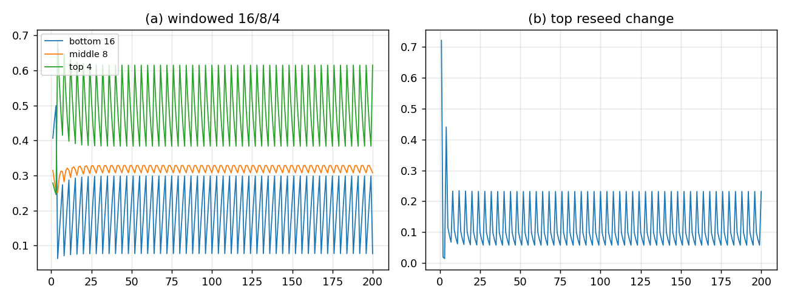

# 窗口化 16/8/4：L=8 动力学 + L=4 读出窗口

## 结论

把 16/8/4 挂在 **$L=4$ 读出窗口的 4 个 site** 上（不是 $H=4$ 的高度层），prototype 跑通了，而且**比 A/B 都更接近观测粗分组**：

| 方案 | 底/中/顶（周期平均） | 到观测的 L1 距离 | $D=4$ | 备注 |
|:--|:--|--:|:--|:--|
| **窗口化 16/8/4（本方案）** | $0.1928/0.3189/0.4883$ | **$0.1268$** | ✅ $q_{\rm rot}=5/9$ | $L=8$ 动力学 + $L=4$ 读出窗 |
| A：$L=8$ 整词 top2 | $0.1978/0.3255/0.4766$ | $0.1502$ | ❌ $19/175$ | 整词读出 |
| B：$K_4$ 纤维 | $0.2249/0.3611/0.4140$ | $0.2754$ | ✅ | 纤维 profile 标定 |
| 8/4/2：$L=4$ 词类 | $0.2331/0.3719/0.3951$ | $0.3133$ | ✅ | 底只有 8 |
| 观测粗分组 | $0.1724/0.2759/0.5517$ | — | — | — |

**窗口化 16/8/4 是目前最接近观测、又保住 $D=4$ 的方案。**



## 结构

- $L=8$ 的 70 个平衡词，共 **180 个平衡 4-窗口**（每位置 36 个）；
- 读出窗口长度 $4$：4 个 **site** $j=0..3$；
- 每个 site 带两个二元标签：字母符号 $\sigma$、窗口面积奇偶 $\pi$；
- 16 类 $=(j,\sigma,\pi)=4\times2\times2$；
- 中层 8 $=(j,\sigma)$；顶层 4 $=j$；
- 毁灭 $T=4$：底 16 全灭；中留最高 site $j_*$ 的两个 $\sigma$；顶 4 个 site 不动；
- reseed 用窗口类 $\rho$ 的 push-forward；顶/中未毁层继续收 seed/flow。

**$D=4$ 保住的理由**：整词 $q_{\rm rot}(8)=19/175$ 仍在窗外，但**读出窗口**的 $q_{\rm rot}=5/9$；物理读出取 4-窗口，所以四维窗没被动。

## 相位表

| 相位 | 底 16 | 中 8 | 顶 4 |
|:--|--:|--:|--:|
| 1（毁灭后第 1 代） | $0.1595$ | $0.3267$ | $0.5138$ |
| 2 | $0.2337$ | $0.3272$ | $0.4391$ |
| 3 | $0.3016$ | $0.3162$ | $0.3822$ |
| 4（毁灭代） | $0.0764$ | $0.3055$ | $0.6181$ |
| 平均 | $0.1928$ | $0.3189$ | $0.4883$ |

- 底从毁灭代 $0.076$ 经 $0.160\to0.234\to0.302$ 逐代长回；
- 中留着的 2 类继续收种，毁掉的 6 类从 $\rho$ 长回；
- 顶 4 个 site 每代在 $0.382$–$0.618$ 间变，不是静态；
- 底周期 4（FFT bin 50 $=10.6$）。

## 判据（6/6 PASS）

1. 4 site $\times2\times2=16$ 类；
2. $\rho$ 归一；
3. 180 个平衡 4-窗口；
4. 毁灭代底份额低于中/顶；
5. 未毁顶在变（max $0.72$）；
6. 底有周期 4 分量。

## 边界

- 这是三层通道 prototype，不是 12 通道忠实引擎；它验证的是 **窗口化 16/8/4 的毁灭/reseed**。
- **窗口读出是新定义**：物理读出 = 长度 4 的滑动窗口；Z062 的整词 $q_{\rm rot}(8)$ 仍是 $19/175$，不能无条件替换。
- “4 个 site”与 L1 的 $h,\sigma,\pi$ 是否是同一组标签，还没证明；目前用 site+窗口面积奇偶。
- **无新量纲锚**：$4,2,2$、窗口、$\rho$ 都无量纲；$v$ 仍是唯一锚。

## 下一步

1. 把窗口化 16/8/4 接进 12 通道忠实引擎：L1→L2 seed 用窗口类 $\rho$，而不是直接改 $n$。
2. 把“每类计数”换成**最近两代的窗口记录**（top2），看顶能否到 $0.55$。
3. 证明窗口 $q_{\rm rot}=5/9$ 的组合命题（每位置 36 个；$W_8$ 的 4-窗口旋转类分布与 $W_4$ 相同）。

## 复跑

```bash
cd ZeroGPU/src
/usr/bin/python3 zero_window_16.py
```

| 文件 | 内容 |
|:--|:--|
| `ZeroGPU/src/zero_window_16.py` | 窗口化 16/8/4 的 $\rho$ 与毁灭/reseed |
| `ZeroGPU/results/zero_window_16.json` | $\rho$、每代份额、相位、判据 |
| `ZeroGPU/results/zero_window_16.png` | 三层份额与顶 reseed 变化 |

---

*ZeroGPU · 窗口化 16/8/4 · 2026-10-18*
