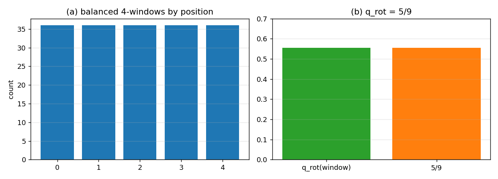

# L=4 与 L=8：漏掉的可能是“读出窗口 ≠ 词长”

## 结论

**你的怀疑有道理。** 我们之前把 $L$ 同时当成两件事：

1. **动力学词长**（word length，闭合唱片的长度）；
2. **读出窗口**（Z062 的四维窗，$q_{\rm rot}(L)\in(1/2,3/5)$）。

Z062 锁的是**读出窗口** $L=4$，不一定是**动力学词长**。如果读出是 $L=4$ 的窗口，那么 $L=8$ 的词里**仍然有 $L=4$ 的四维读出**：

| 量 | 结果 |
|:--|:--|
| $W_8$ 词数 | $70$ |
| 含至少一个平衡 4-窗口的词 | **$70/70$** |
| 平衡 4-窗口总数 | **$180$** |
| 五个窗口位置（0–4） | 每个 **$36$** 个 |
| 这些 4-窗口的 $q_{\rm rot}$ | **$5/9=0.5556$**（恰在四维窗内） |
| 首半/尾半平衡的词 | $36/36$ |



**读法**：$q_{\rm rot}(8)=19/175=0.1086$ 是**整词**的统计；若物理读出取 $L=4$ 的**窗口**，窗口的 $q_{\rm rot}$ 回到 $5/9$。所以 $L=8$ 与 $L=4$ **在读出层可以是同一个四维窗**，差别只在**动力学词长/分辨率**。

## 这对 16/8/4 的含义

- 16/8/4 的“4 个基”不必是 $H=4$（$L=8$ 的高度层）；它可以是 **$L=4$ 读出窗口的 4 个位置（4 个 site）**。
- 这样 16 类 $=4$ 个 site $\times2\times2$；中层 8、顶层 4；**$L=4$ 的读出窗口和 $D=4$ 都保住**。
- $L=8$ 只提供**更长的动力学词**和窗口；“4 基”来自读出窗口的 4 个 site，不是 $H=4$。这消掉了“$L=8$ 必须放弃 $D=4$”的表面冲突。
- 三个 L2 亚层就是 4 个 site 上两个二元标签的三级分辨率；毁灭规则仍是底全灭、中留最高 site 的 2 个、顶 4 个 site 不动。

## 但这不是自动等价

- **整词** $q_{\rm rot}(8)=19/175$ 仍然在四维窗外；只有**窗口读出**才回到 $5/9$。
- 所以“$L=4$ 与 $L=8$ 实际一样”这句话要限定为：**读出层一样（L=4 窗口），动力学层不一样（整词长度/谱不同）**。
- 这是一个**新的读出定义**：物理读出 = 长度 4 的滑动窗口，而不是整词。它需要单独登记，不能偷偷替换 Z062 的整词 $q_{\rm rot}$。
- 16 类映射到“4 个 site”也是新的识别；还没有证明它和 L1 的 $h,\sigma,\pi$ 是同一组标签。

## 下一步

1. **写清读出窗口的定义**：物理读出是长度 $L_{\rm read}=4$ 的窗口；整词长度 $L_{\rm word}$ 可大于 4。$q_{\rm rot}$ 用窗口算，$D=4$ 由窗口给。
2. **窗口化 16/8/4**：4 个 site $\times2\times2$；毁灭/Reseed 用窗口类；检查周期 4 和观测粗分组。
3. **证明窗口 $q_{\rm rot}=5/9$ 不是偶然**：$W_8$ 的 180 个平衡 4-窗口的旋转类分布与 $W_4$ 相同；这可以写成一条组合命题（每个窗口位置 36 个，$q=5/9$）。
4. **如果窗口读出成立**，$L=8$ 就不再与 $D=4$ 冲突；如果不成立（读出必须整词），$L=8$ 仍然出局。

## 复跑

```bash
cd ZeroGPU/src
/usr/bin/python3 zero_window_readout.py
```

| 文件 | 内容 |
|:--|:--|
| `ZeroGPU/src/zero_window_readout.py` | $W_8$ 的平衡 4-窗口计数与 $q_{\rm rot}$ |
| `ZeroGPU/results/zero_window_readout.json` | 70/70、180、36×5、$q=5/9$ |
| `ZeroGPU/results/zero_window_readout.png` | 窗口计数/位置图 |

---

*ZeroGPU · 读出窗口 vs 词长 · 2026-10-18*
